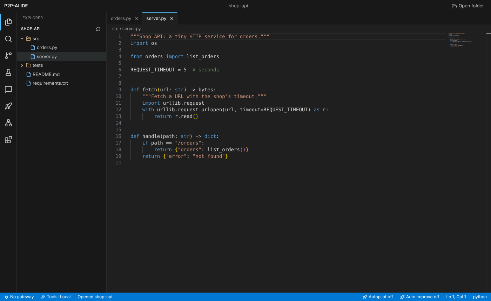
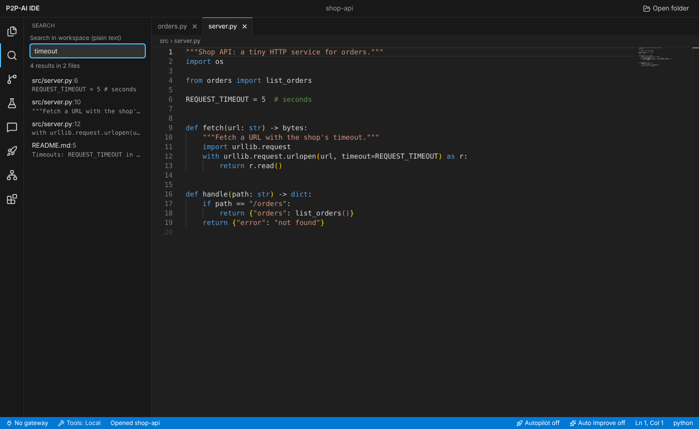
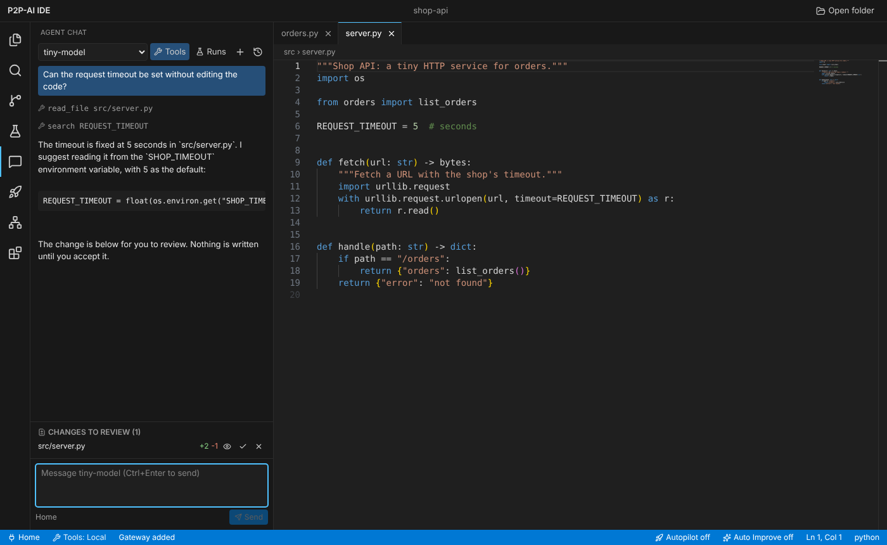
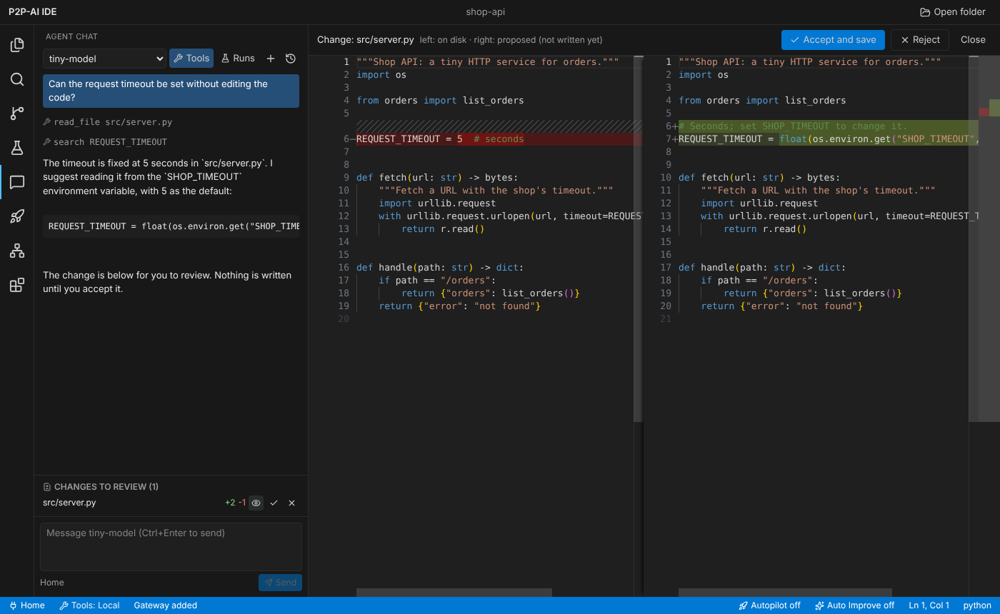
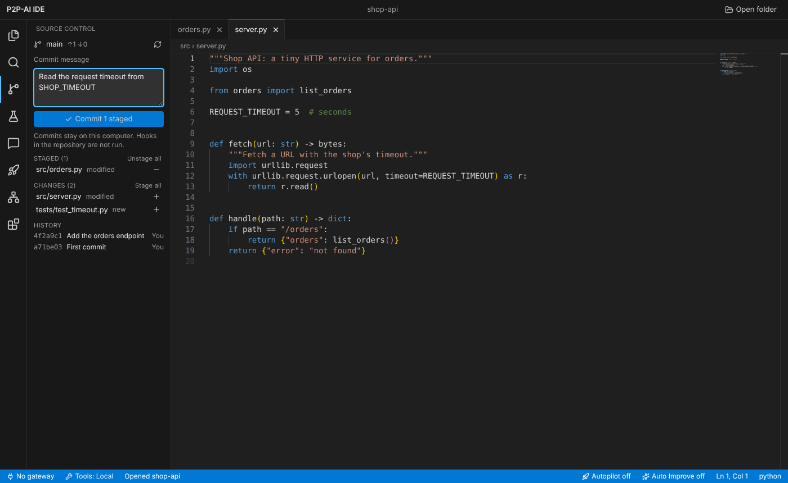
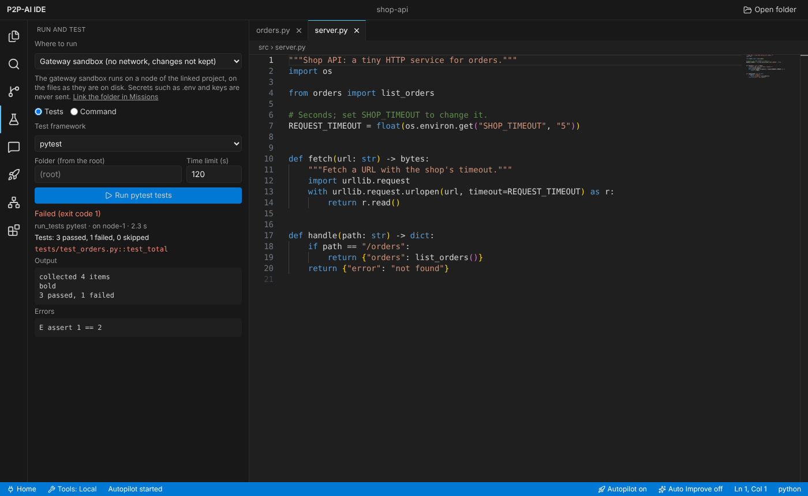
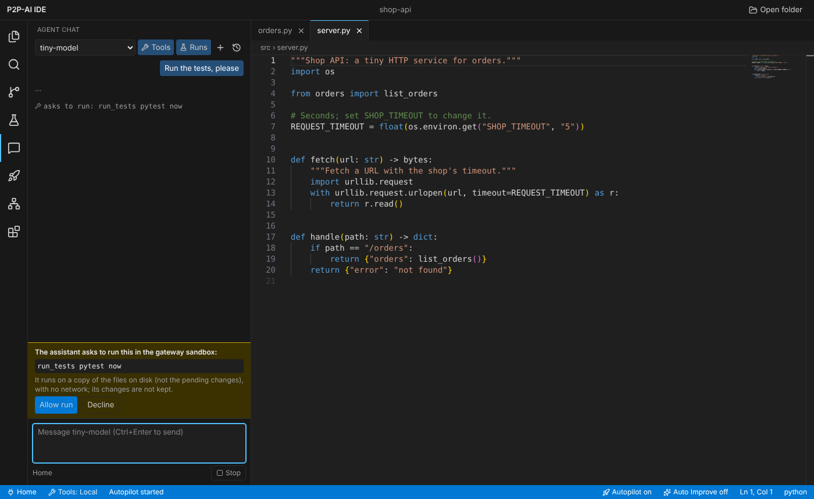
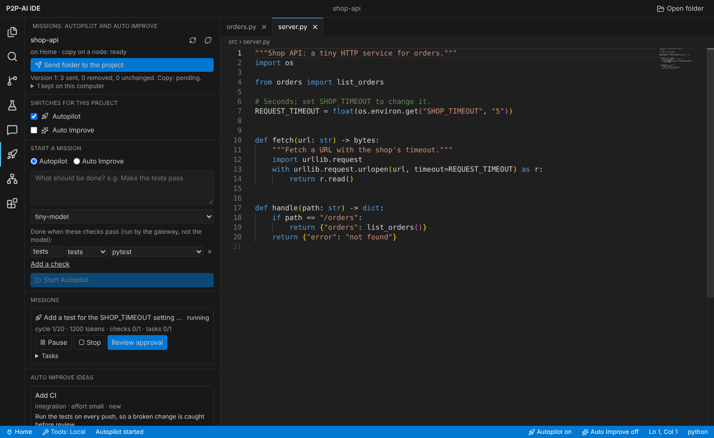
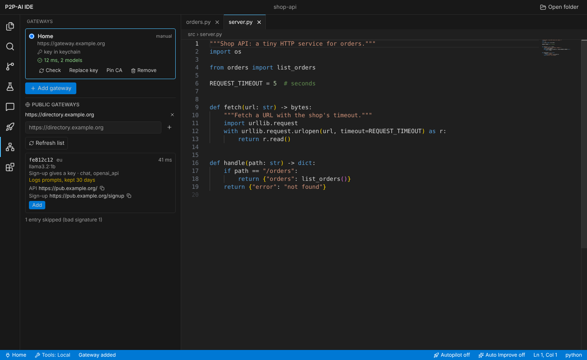

# P2P-AI IDE

**A code editor with AI agents built in, powered by the P2P-AI network.** Open a folder, edit in a VS Code-style
editor (Monaco), and ask the network's models for help. The assistant can read your project and propose edits, but
**nothing is written until you review the change and accept it**, and nothing runs until you allow it.



It is a desktop app (Rust + React, built with Tauri) for Windows and Linux. It is for people *using* the network; if
you want to lend your computer to the network, that is the [P2P-AI desktop app](https://github.com/Shatoshinakamoto/P2P-AI).

## What you can do

| | |
|---|---|
| **Edit your code**<br>Open a folder, browse it, edit in tabs with syntax highlighting and multi-cursor, save with Ctrl+S. If a file changed on disk since you opened it, the IDE warns you instead of overwriting it. | [](docs/user-guide.md#2-open-a-folder-and-edit) |
| **Search everything**<br>Plain-text search across the whole folder; click a result to jump to the line. | [](docs/user-guide.md#3-search) |
| **Chat with an agent about your project**<br>Ask a question; the assistant reads files and searches the folder (each step is shown), explains, and proposes changes. | [](docs/user-guide.md#6-chat-with-the-agent) |
| **Review every change as a diff**<br>Proposed edits wait under *Changes to review*. Open one side by side, then **Accept and save** or **Reject**. | [](docs/user-guide.md#7-review-a-proposed-change) |
| **Source control**<br>See what changed, stage, view diffs and commit, using the git already on your computer. | [](docs/user-guide.md#4-source-control) |
| **Run and test safely**<br>Run your tests or a command in a sandbox: on a gateway node, in a local OS sandbox, or in a Docker or Podman container. | [](docs/user-guide.md#9-run-and-test) |
| **Approve each run the agent asks for**<br>When the assistant wants to run something, a card shows exactly what and where. You choose **Allow run** or **Decline**. | [](docs/user-guide.md#10-let-the-agent-run-tests-with-your-approval) |
| **Missions: Autopilot and Auto Improve**<br>Hand a bigger goal to the network. It plans, edits and checks, and waits for your approval on each write. | [](docs/user-guide.md#8-missions-autopilot-and-auto-improve) |
| **Your gateways, your keys**<br>Add your own gateway or pick one from a signed public list. Keys go into your operating system's keychain and are never shown again. | [](docs/user-guide.md#5-connect-to-a-gateway) |

**The full tour, with every screen explained:** [docs/user-guide.md](docs/user-guide.md).

## Get started

1. **Install** the IDE from a signed release (Windows `.exe`/`.msi`, Linux `.deb`/`.rpm`); see
   [docs/features/installers.md](docs/features/installers.md) for how to check the signature.
2. **Open a folder** with your code.
3. **Add a gateway** (the Gateways view): your own, or one from a public directory. Paste its key once.
4. **Ask the agent** in the Agent chat, review its changes, and accept the ones you like.

## Build from source

Needs Rust stable, Node 22 and the [Tauri prerequisites](https://v2.tauri.app/start/prerequisites/)
(on Linux: `libwebkit2gtk-4.1-dev`, `librsvg2-dev`).

```
cd app
npm ci --ignore-scripts
npm run tauri dev       # development window
npm run release         # release binary, no installer
```

Tests: `cd core && cargo test`, `cd app && npm test && npm run build && npm run ui-smoke`. Details in
[docs/commands/app-scripts.md](docs/commands/app-scripts.md). The screenshots are retaken with
`node tests/docs-shots.mjs` ([docs/commands/docs-screenshots.md](docs/commands/docs-screenshots.md)).

## Status

Built: the editor (phase I1), gateways and chat (I2), agent tools and diff review (I3), missions (I4), source control,
run and test, the local OS sandbox and the container runner (I5). Next: extensions (I6). The plan and its decisions
(ADR-029) are in the P2P-AI repository, `docs/restructure/agentic-ide-plan.md`; every change is in
[docs/CHANGELOG.md](docs/CHANGELOG.md).

## Layout

| Folder | What it is |
|---|---|
| `core/` | Rust core: file operations with path confinement and size caps, gateways, agent, missions, git, sandboxes |
| `app/src-tauri/` | Tauri shell: the typed commands, the folder picker, CSP and permissions |
| `app/src/` | React webview: layout, explorer, search, Monaco editor, chat, missions, run and test |
| `docs/` | Documentation ([index](docs/README.md)) |
| `HistoryTest/` | Record of every test run (development only, never shipped) |

## Security

In short: the assistant only *proposes* edits; you accept each one. Every run needs your approval and runs in a
sandbox with no network. Gateway keys live in the OS keychain. The window runs under a strict Content-Security-Policy,
and text from models is always shown as text. Development follows [CLAUDE.md](CLAUDE.md); each feature page in
[docs/features/](docs/features/) has its threat model and controls, and changes go in
[docs/SECURITY-LOG.md](docs/SECURITY-LOG.md).

## Licence

Apache-2.0 (see LICENSE and NOTICE).
