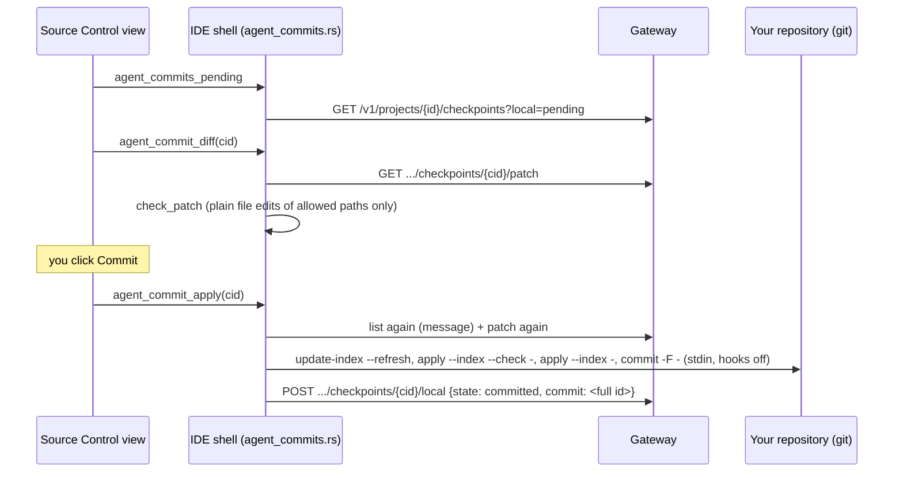

# Agent commits: commit an agent's checkpoint in your own repository

Status: **built 2026-11-23** (IDE side of the gateway's `git_commit` mode `local`; P2P-AI
`docs/features/git-commit-tool.md`). Verified on the PC: see section 8.

## 1. Overview

An agent on the P2P-AI network works on a copy of your project on a node. When it calls `git_commit` with mode
`local`, the gateway saves a named checkpoint and keeps it waiting for you. The IDE's **Source Control** view lists
these under **From the agent**. You read the message and the diff. If you say yes, the IDE applies the change to
the open folder and commits it in your own repository, with your own git name and email. If you say no, it rejects
the commit. Either way the agent is told the outcome.

## 2. How it works

- **Core** `core/src/scm.rs`: `check_patch` and `Repo::apply_checkpoint`. `core/src/projects.rs`: `checkpoint_view`.
- **Shell** `app/src-tauri/src/agent_commits.rs`: four commands (`agent_commits_pending`, `agent_commit_diff`,
  `agent_commit_apply`, `agent_commit_reject`).
- **View** `app/src/components/AgentCommits.tsx`, inside `SourceControlView.tsx`. It reads the list again every 30 s
  while the view is open.

## 3. How it is secure

| Threat | Control | Reference |
|---|---|---|
| A model changes your repository without you | Nothing touches the repository until you click Commit; listing and showing are read-only | OWASP LLM06, NIST AC-3 |
| A patch that writes outside the folder, into `.git`, or makes a link | `check_patch` allows only `diff --git a/P b/P` with the same path, the 100644 mode lines, and hunks whose counts match exactly. Paths must be relative with "/", have no empty, `.`, `..` or `.git` part, no `\`, no `:`, and pass the workspace allow-list. Renames, copies, mode changes, symbolic links, binary patches and anything else are refused. `git apply` checks paths again | CWE-22, CWE-59, CWE-73, CWE-20 |
| Command or option injection through the patch or the message | Both go to git on standard input (`apply -`, `commit -F -`), never as arguments; git runs without a shell | CWE-77, CWE-78, CWE-88 |
| Repository programs (hooks, filters) running | The existing source control rules: hooks off (`core.hooksPath` to the null device, `--no-verify`), risky repository settings refused | CWE-829 |
| Your own staged work ends up in the agent's commit | Refused while anything is staged | — |
| Half-applied change | `git apply --check` first; `git apply` is all or nothing; a failed commit is undone with `apply -R` | CWE-460 |
| What was shown is not what is committed | The patch and message are fetched again and checked right before applying | CWE-367 |
| Ids that change the URL | `id_ok` before any path | CWE-74, CWE-918 |
| Gateway text in the view | Rendered by React as text in `<pre>` | CWE-79 |
| Audit | Fixed words only: `agent-commit made`, `rejected`, `failed` | NIST AU-2, CWE-532 |

## 4. How to use it

1. Open the project folder in the IDE. It must be a git repository at the state of the agent's previous checkpoint,
   for example after **Pull** from the project.
2. Link the folder to its gateway project (Missions view).
3. An agent run on that project calls `git_commit` with `mode: "local"` (you approve that call in the run).
4. Open **Source Control**. Under **From the agent**, click the commit to see its message and diff.
5. Click **Commit**. The notice shows the new commit's id. Or click **Reject**.

If the change does not fit your files, nothing is changed. The agent is told it failed, and the IDE explains why.

## 5. Dependencies

No new crate or npm package. It uses the person's installed `git`, like the Source Control view.

## 6. Limitations and known risks

- Your folder must match the previous checkpoint. If it does not, the patch does not apply. Pull first, or apply
  the downloadable patch yourself with `git apply -3`.
- Files the gateway could not put in the patch (binary or too large) are named in the checkpoint's message. Take
  them from the project's export.
- A patch over 5 MiB is not downloaded (the IDE's transfer limit).
- If the commit succeeds but the gateway cannot be reached, the commit stays and the notice says the gateway was
  not told. The checkpoint stays pending on the gateway; reject it there or retry.

## 7. Troubleshooting

| Message | Fix |
|---|---|
| "commit or unstage your own staged changes first" | Commit or unstage your work, then click Commit again |
| "the agent's change does not fit this folder's files" | Pull the project or check out the previous checkpoint's state |
| "the agent's change is not a plain text patch of files in this folder" | Refused on purpose (a path or kind of change that is not allowed); look at it on the gateway |
| "set your name and email in git first" | `git config --global user.name` and `user.email` |
| Nothing under From the agent | The folder is not linked, or no commit waits |

## 8. Test evidence

- PC (Windows): run 1 [2026-11-23_042344Z_ide-core_4bc367d](../../HistoryTest/runs/2026-11-23_042344Z_ide-core_4bc367d/RUN.md) fail (line endings in the test), run 2 [2026-11-23_042344Z_ide-core_5d10b7b](../../HistoryTest/runs/2026-11-23_042344Z_ide-core_5d10b7b/RUN.md) fail (test setup ran the hook; app and shell checks pass), run 3 [2026-11-23_042414Z_ide-core_f256ea5](../../HistoryTest/runs/2026-11-23_042414Z_ide-core_f256ea5/RUN.md) **pass**.
- Cloud first try: [2026-11-23_040711Z_ide-core_d834367](../../HistoryTest/runs/2026-11-23_040711Z_ide-core_d834367/RUN.md) fail (2, fixed).
- Not yet tried: the Source Control view by hand against a live gateway with a real agent run.
