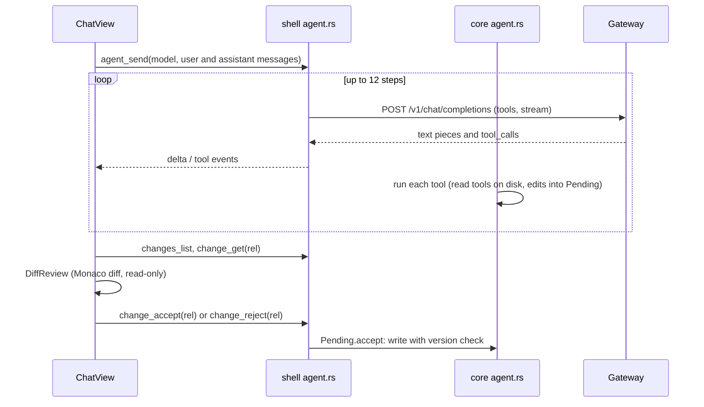

# Chat tools on the open folder, with diff review (phase I3)

* **Status:** built 2026-11-17 after phases I1 and I2 were merged (PR #1). Phase I3 of the IDE plan in the P2P-AI
  repository (`docs/restructure/agentic-ide-plan.md`, ADR-029 D3: local chat tools by default). Requested by Pheonix
  ("keep moving forward", 2026-11-17).
* **Code:** `core/src/agent.rs`, `core/src/client.rs` (`agent_step`, streamed tool calls), `app/src-tauri/src/agent.rs`,
  `app/src/components/{ChatView,DiffReview,Editor}.tsx`, `app/src/App.tsx`, `app/src/ipc.ts`.
* **Next:** I4 missions (sync to a gateway project, Autopilot and Auto Improve), I5 sandboxed commands.

## 1. Overview

With a folder open and **Tools** on (the default), Agent chat becomes an assistant that can look at the code: it lists
folders, reads files and searches, and it can propose edits and new files. Nothing it proposes is written. Proposed
changes collect under **Changes to review**; the person opens each one in a side-by-side diff over the editor and
presses **Accept and save** or **Reject**. Every tool step appears in the chat as a short line, such as
`read_file src/orders.py`. With **Tools** off, or with no folder open, the chat works as in phase I2.

## 2. How it works

* The gateway API is the client-executed tools surface every P2P-AI gateway serves (`tools`, `tool_calls`,
  `role: "tool"`; P2P-AI `docs/protocol-and-api.md` section 3). The gateway and its nodes never run the tools.
* **Tools:** `list_dir {path}`, `read_file {path, start_line?, end_line?}`, `search {query}`,
  `edit_file {path, old_text, new_text}` (old_text must appear exactly once), `create_file {path, content}` (the file
  must not exist; its folder must).
* **Pending changes:** one entry per file with the disk text, the proposed text and the disk version it was based on.
  Later reads by the model see its own proposed text, so several edits to one file build on each other. The list
  lives in memory for the open folder and is cleared when another folder opens.
* **Accept** uses the editor's own save (atomic, version-checked). If the file changed on disk after the assistant
  read it, the accept is refused. An open editor tab without unsaved edits reloads; one with unsaved edits shows the
  conflict bar.
* **Saved chats:** tool steps are kept as `tool` lines (see [files/app-data.md](../files/app-data.md)); only user and
  assistant text is sent to the model in later turns.

| Command | Arguments | Returns |
|---|---|---|
| `agent_send` | `model`, `messages`, `onEvent` channel | `{steps, tool_calls, pending, finish_reason}`; events `{kind: "delta", text}` and `{kind: "tool", name, target, ok}` |
| `changes_list` | none | `[{rel, created, added, removed}]` |
| `change_get` | `rel` | `{rel, before, after, created}` |
| `change_accept` | `rel` | the file's new version |
| `change_reject` | `rel` | nothing |

## 3. How it is secure

Threat model (STRIDE, brief). Assets: the person's code and any secrets in the folder, the integrity of the files.
Attackers: a hostile or confused model, prompt injection planted in a file, README or dependency that the model reads,
a hostile gateway answer.

| Threat | Control | Reference |
|---|---|---|
| The model changes or destroys code on its own | no tool writes, deletes, renames or runs anything; every change is a pending proposal written only on the person's Accept, per file, after a diff | OWASP LLM06, NIST AC-6, CISA Secure by Design |
| Prompt injection in a file steers the model | the worst it can do is propose an edit the person sees in the diff, or read more of the folder; the system prompt labels tool output as data; every tool step is shown | OWASP LLM01 |
| Secrets in the folder sent to the gateway | deny list for `.env` (not `.env.example`), keys and certificates (`.pem`, `.key`, `.p12`, `.pfx`, `.jks`, `.kdbx`), `id_rsa`-style files, `.npmrc`, `.pypirc`, `.netrc`, `.git-credentials`, `credentials.json`, and `.git/`, `.ssh/`, `.gnupg/`, `.aws/`, `.docker/`, `secrets/` folders; denied names are also left out of listings and search results | CWE-200, CWE-538 |
| Path tricks | every path goes through the workspace's allow-list and canonical confinement, as for the person | CWE-22, CWE-59, CWE-73 |
| Lost update | accept carries the version the proposal was based on; a changed file is refused | CWE-367 |
| Malformed or hostile tool calls | strict argument objects (only the tool's keys, right types); unknown tools answered with an error, never run; ids and names capped | CWE-20 |
| Resource exhaustion | 12 steps per turn, 8 calls per step, 1 MiB arguments per call, 64 KiB per tool result, 1 MiB of results per turn, 2 MiB request, 50 pending files, 5 MiB per proposed file, one turn at a time, Stop | CWE-400, CWE-770 |
| Hostile text in the UI | answers, tool targets and diff texts are React text or read-only Monaco models; links off | CWE-79 |
| Logs | fixed audit words only: agent turn, change accepted, change rejected; no paths, tool names or text | NIST AU-3, CWE-117, CWE-532 |

## 4. How to use it

1. Open a folder and make sure a gateway with a key is active (Gateways view).
2. Open **Agent chat**. **Tools** is on (highlighted). Pick a model that supports tools.
3. Ask, for example: `Why does orders() return an empty list? Fix it.` Watch the tool lines appear.
4. Under **Changes to review**, press the eye button on a file to see the diff (left: on disk, right: proposed).
5. Press **Accept and save** to write it, or **Reject**. The check and cross buttons in the list do the same without
   opening the diff.
6. Press **Tools** to switch to plain chat.

## 5. Dependencies

No new dependencies. Uses ureq, serde_json and Monaco's diff editor (monaco-editor 0.57.0, already pinned).
cargo audit and npm audit 2026-11-17: 0 vulnerabilities (run linked below).

## 6. Limitations and known risks

* The model needs tool support. Small models may write calls as text; the gateway's text-tool fallback serves agent
  runs, not chat, so such a model just answers in text here.
* The deny list is by name. A secret in an ordinary file (for example a key pasted into `config.py`) can be read and
  sent to the gateway. Keep secrets out of the code folder, or turn Tools off.
* What the model reads goes to the gateway you chose, like anything you paste.
* Pending changes are kept in memory only: closing the app drops them.
* No delete, rename or command tools yet (I5 adds sandboxed commands).
* The `TODO(security)` in `workspace.rs` (openat-style handles against a folder swapped for a symlink mid-operation)
  is still open; it needs another local program racing the IDE, and every agent write still waits for an Accept.

## 7. Troubleshooting

| Message | Cause and fix |
|---|---|
| "open a folder first; the assistant works on the open folder" | open a folder, or turn Tools off |
| "this gateway or model does not offer tools; turn Tools off to chat without them" | the gateway answered 404 for a tools request; pick another model or turn Tools off |
| tool line `failed: read_file .env` | that file is hidden from the assistant on purpose |
| "the file changed on disk after the assistant read it; reject this change and ask again" | the file was edited after the proposal; reject it and ask again |
| "the chat and the files read are larger than 2 MiB; start a new chat" | the turn read too much; start a new chat or ask about fewer files |

## 8. Test evidence

* [Core: fmt, clippy, 48 tests incl. agent tools, deny list, pending changes, turn budgets, loopback tool call](../../HistoryTest/runs/2026-11-17_065236Z_core_e919fcd/RUN.md)
* [Tauri shell: fmt and clippy with the agent commands](../../HistoryTest/runs/2026-11-17_065239Z_shell_e919fcd/RUN.md)
* [Webview: UI smoke 45/45 with tool steps, diff review, accept, reject and Tools off](../../HistoryTest/runs/2026-11-17_065240Z_ui-smoke_e919fcd/RUN.md)
* [cargo audit and npm audit: 0 vulnerabilities](../../HistoryTest/runs/2026-11-17_065249Z_security-scan_e919fcd/RUN.md)
* Windows click-through: still to do, together with I2.
