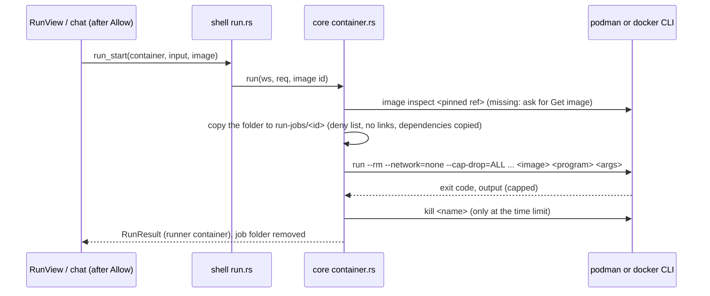

# Local container runner: Docker or Podman (phase I5d)

* **Status:** built 2026-11-17 after phase I5c was merged (PRs #10 and #11). Requested by Pheonix on 2026-11-17:
  "include support for local container like docker or podman". Images follow the recommended option on the
  2026-11-17 decision card ("Red Hat UBI per framework"); if Pheonix picks another option, only the image list in
  `core/src/container.rs` changes.
* **Code:** `core/src/container.rs` (engine, image list, Get image, run arguments, run),
  `core/src/localbox.rs` (shared snapshot, cache and output helpers), `app/src-tauri/src/run.rs`
  (`runners_list`, `run_on`, `container_images`, `container_prepare`), `app/src-tauri/src/agent.rs` (chat runs),
  `app/src/components/{RunView,ChatView}.tsx`, `app/src/{App.tsx,ipc.ts}`.
* **Tests:** `core/src/container.rs` (locked-down arguments, pinned images, image choice),
  `core/examples/local_containers.rs` (real engine: confinement and cargo, go, npm, make, unittest),
  `app/tests/ui-smoke.mjs` (runner list, Get image, image sent with the run).

## 1. Overview

**Run and test** has a third place to run: **Local container, Docker or Podman**. A run goes into a throw-away
container on this computer, on a copy of the folder, with no network, no capabilities, not as root, on a read-only
image, and its changes are thrown away. The result looks like any other run. The chat's **Runs** use it when it is
picked in Run and test, and the approval card says "in a local container on this computer".

Tests pick their image from the framework; a **Command** runs in the image chosen in the **Image** list:

| Image id | Image | Used by |
|---|---|---|
| `python` | `registry.access.redhat.com/ubi9/python-312@sha256:5b184c2a...` | pytest, unittest, commands |
| `node` | `registry.access.redhat.com/ubi9/nodejs-22@sha256:623c4bda...` | npm, commands |
| `go` | `registry.access.redhat.com/ubi9/go-toolset@sha256:4053e919...` (has make and gcc) | go, make, commands |
| `rust` | `localhost/p2p-ide-rust:ubi9-1e9f0ed9`, built here from `ubi9/ubi@sha256:1e9f0ed9...` with `rust-toolset` | cargo, commands |

The digests were taken from the registry on 2026-11-17; the full values are in `core/src/container.rs`. Red Hat
publishes no Rust image, so that one is built on this computer from the pinned UBI 9 base.

A run never downloads anything. When an image is missing, the view shows **Get image**, which pulls it by digest
(or builds the Rust image) and then allows the run.

## 2. How it works

* **Engine.** Podman first (rootless by default), then Docker, found in absolute PATH folders. The runner is
  offered when `<engine> version` answers within 15 seconds.
* **Snapshot.** The same copy as the local sandbox (deny list, no links, caps), except that `node_modules` and
  `.venv` are copied instead of linked, since a host link would point nowhere inside the container.
* **Mounts.** Only two: the job folder at `/work` and the folder's cache at `/cache` (Cargo target, Go and npm
  caches). On SELinux hosts both get `:Z`, which relabels only these IDE-owned folders.
* **User.** Linux: the person's own uid and gid (with Podman, `--userns=keep-id`), so the files stay theirs.
  Docker Desktop and Podman machine (Windows, macOS): uid 1000. Never root.
* **Environment.** `HOME=/work/.p2pide-home`, `TMPDIR=/tmp`, `GOTMPDIR=/work/.p2pide-tmp` (since `/tmp` is mounted
  without execute), `CI=true`, the cache variables and the framework's offline settings.
* **Time limit.** At the limit the container is killed by its name (`p2pide-run-<16 hex>`); killing only the
  command-line client would leave it running.

## 3. How it is secure

| Threat | Control | Reference |
|---|---|---|
| Network exfiltration or attacks | `--network=none` | NIST SC-7; CWE-918 |
| Gaining privileges, escaping | `--cap-drop=ALL`, `--security-opt=no-new-privileges`, non-root user, no `--privileged`, host namespaces, devices or engine socket (checked by a test) | CIS Docker 5.3, 5.4, 5.25; NIST AC-6; CWE-250, CWE-269 |
| Changing the image or the host | `--read-only` root, small `/tmp` tmpfs (`nosuid,nodev`, no execute), only the job folder and cache mounted | CIS Docker 5.12; CWE-284 |
| Reading secrets | the deny list keeps `.env`, keys and `.git` out of the copy; nothing else of the person's is mounted | CWE-200, CWE-522 |
| Resource exhaustion | 1024 processes, 8 GiB memory (no extra swap), 4096 open files, no core dumps, wall-clock kill | CIS Docker 5.10, 5.28; CWE-400, CWE-770 |
| Tampered or swapped images | a fixed list pinned by digest; `--pull=never` during runs; downloads only by Get image | SLSA; NIST SR-3, SI-7; CWE-494 |
| Injection through the request | argument lists only, no shell; program by name; image id from a fixed list | CWE-78, CWE-88, CWE-20 |
| Planted engine binary | the engine is taken from absolute PATH folders only | CWE-426 |
| Hostile output | cleaned, capped (64 KiB per stream), rendered as text | CWE-150, CWE-79 |

Writing code to these standards does not make the IDE "CIS-compliant"; formal compliance needs an assessment.

## 4. How to use it

1. Install Podman (recommended: rootless) or Docker, and start it (Docker Desktop, or `podman machine start` on
   Windows and macOS).
2. Open a folder, press the flask icon (**Run and test**) and choose **Local container, Docker or Podman**.
3. Pick **Tests** and a framework, or **Command** and an **Image**. If the view says the image is not on this
   computer yet, press **Get image** (it downloads once).
4. Press **Run ... tests** or **Run command**.
5. For the chat, keep that runner selected and turn **Runs** on.

## 5. Dependencies

No new crates. The Docker or Podman command line, installed by the person. Images: Red Hat UBI 9 (Python 3.12,
Node.js 22, Go toolset, UBI base for Rust), pinned by digest on 2026-11-17. cargo audit and npm audit on 2026-11-17
(runs linked below). Image contents are Red Hat's; check them with `podman image scan`-style tools (for example
`trivy image <ref>`) before relying on them.

## 6. Limitations and known risks

* **Shared kernel (accepted risk):** a container shares the host's kernel; a kernel or engine escape is out of
  scope. Rootless Podman limits the damage; with rootful Docker the daemon runs as root, so the IDE never passes
  privileged flags or extra mounts.
* **The Rust image is built from UBI packages** that are not pinned one by one (`dnf install rust-toolset`), so two
  builds can differ. The base image is pinned.
* **No network:** tests that need a server or packages from the internet fail. pytest is not in the Python image;
  put it in the project's `.venv` (copied into the container) or use unittest.
* Cargo has no access to the person's `~/.cargo` registry in the container: projects with dependencies need them
  vendored (`cargo vendor`).
* The build cache keeps built dependencies between runs; the project's own crate or package is rebuilt each run
  (each run works on a fresh copy).
* Images are multi-architecture (amd64, arm64, s390x, ppc64le).

## 7. Troubleshooting

| Message | Cause and fix |
|---|---|
| "install Podman or Docker to use containers" | neither is on PATH; install one |
| "Docker is installed but not running ..." | start Docker Desktop or the service |
| "Podman is installed but does not answer ..." | `podman machine start` (Windows, macOS) |
| "the ... image is not on this computer yet; press Get image first" | press **Get image** |
| "the image could not be downloaded ..." / "... built ..." | check the network or proxy; for the Rust image the UBI repositories must be reachable |
| Result "the container could not be started" (exit 125) | the engine refused (for example a cgroup limit not supported on this host) |
| Result "the program is not in this image" (exit 127) | pick another image for the command |
| "pick an image from the list" | only the four listed images can be used |

## 8. Test evidence

Links are added with the runs of this change.
