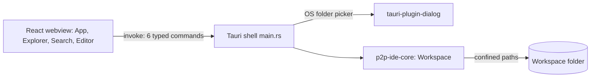

# Editor shell (phase I1)

* **Status:** built 2026-11-17. First phase of the IDE plan in the P2P-AI repository
  (`docs/restructure/agentic-ide-plan.md`, ADR-029). Requested by Pheonix, who approved the mockup on 2026-11-17.
* **Code:** `core/` (Rust core), `app/src-tauri/` (Tauri shell), `app/src/` (React webview).

## 1. Overview

The P2P-AI IDE is an end-user app for working on code with the P2P-AI network's agents. Phase I1 is the editor
itself, with no network code yet: open a folder, browse and search it, edit files in tabs with Monaco (the editor core
of VS Code) and save them. The layout copies VS Code so people feel at home, and already shows where chat, missions,
gateways and extensions will go, each marked with the phase that brings it.

What works now:

* **Open folder** through the system's folder picker.
* **Explorer** tree; folders load when expanded and stay expanded when you switch views.
* **Editor tabs**: one Monaco model per file, so each tab keeps its own undo history; an unsaved dot on the tab; a
  dirty tab needs two clicks to close.
* **Editing**: everything Monaco offers, including multi-cursor (Alt+Click, Add Cursor Below: Ctrl+Alt+Down on
  Windows, Shift+Alt+Down on Linux), column selection, find and replace, and syntax colouring for about 40 languages.
* **Save** with Ctrl+S (Cmd+S on macOS). If the file changed on disk since you opened it, the save is refused and a
  banner offers "Reload from disk" or "Keep editing".
* **Search**: plain text across the workspace, case-insensitive; click a result to open the file at that line.
* **Status bar**: cursor position, language, messages; the gateway, tools, Autopilot and Auto Improve controls are
  shown but disabled until their phases.

## 2. How it works



| Command | Arguments | Returns |
|---|---|---|
| `pick_folder` | none | `{name}` or null when cancelled |
| `workspace_info` | none | `{name}` or null |
| `list_dir` | `rel` (`""` = root) | `{entries: [{name, rel, kind: file|dir|symlink, size}], truncated}` |
| `read_file` | `rel` | `{text, version}` (version = SHA-256 hex of the bytes) |
| `write_file` | `rel`, `text`, `baseVersion` (null = create) | new version |
| `search` | `query` | `{matches: [{rel, line, preview}], truncated}` |

Relative paths always use `/`. The full folder path stays in Rust; the webview only learns the folder's name.

## 3. How it is secure

Threat model (STRIDE, brief): the webview renders untrusted file contents (and later model output), so it is treated as
untrusted input to every command. Assets: the user's files and, later, gateway keys.

| Threat | Control | Reference |
|---|---|---|
| Path traversal out of the folder | relative paths are an allow-list of plain components: no absolute paths, `..`, `.`, empty parts, backslashes, `:`, NUL or control characters, max 1024 bytes; the result is canonicalised and must stay under the canonical root | CWE-22, CWE-73, ASVS V12.3.1 |
| Symlink or junction escape | reads and listings canonicalise and check the root; listings never follow links; saves refuse to write through a link | CWE-59 |
| A page script picks another folder | the folder comes from the OS picker in Rust, never from the webview | NIST AC-6, CWE-73 |
| Too-broad scope | a drive or filesystem root cannot be opened as a workspace | NIST AC-6 |
| Lost update or half-written file | saves carry the loaded SHA-256 version and are refused on mismatch; writes go to a `create_new` temp file in the same folder, are flushed, then renamed | CWE-367, CWE-362 |
| Resource exhaustion | 5 MiB per file, 5000 entries per folder, search 200 matches / 20,000 files / 1 MiB per file / 256-byte query | CWE-400, CWE-770 |
| ReDoS | search is a plain substring, not a regular expression | CWE-1333 |
| XSS in the webview | React and Monaco render text, never HTML; strict CSP (`script-src 'self'`, no remote sources); Monaco's vendored DOMPurify replaced by the patched 3.4.18 | CWE-79, ASVS V14.4 |
| Webview reaching OS APIs | no plugin permissions for the webview (`core:default` only); the dialog plugin is called from Rust | CWE-284, NIST AC-6 |
| Error details leaking | fixed short messages, no paths or OS text | CWE-209 |
| Log forging or leaking | refusals logged to stderr with a timestamp and a fixed kind, never the path | NIST AU-3, CWE-117, CWE-532 |

Known gaps: a small TOCTOU window between the canonical check and the open if another local program swaps a folder
for a link (`TODO(security)` in `workspace.rs`, planned: handle-based access with cap-std before the agent tools in
phase I3). Monaco needs `style-src 'unsafe-inline'` (accepted risk, `docs/SECURITY-LOG.md`).

## 4. How to use it

Developer build (any OS with Rust stable, Node 22 and the Tauri prerequisites; on Linux `libwebkit2gtk-4.1-dev`):

```
cd app
npm ci --ignore-scripts
npm run build              # type check + webview build into app/dist
npm run tauri dev          # window with live reload (dev server on 127.0.0.1:5174)
npm run release            # release binary in app/src-tauri/target/release (no installer)
```

In the app: **Open folder** (title bar or Explorer), click files to open them, edit, press Ctrl+S. Use the magnifier
for search.

## 5. Dependencies

| Name | Version | Purpose | CVE check |
|---|---|---|---|
| monaco-editor | 0.57.0 | the editor | npm audit 2026-11-17: its vendored DOMPurify 3.4.15 has advisories; replaced at build time, see SECURITY-LOG |
| dompurify | 3.4.18 | patched sanitizer used in place of Monaco's copy | npm audit 2026-11-17: clean |
| react, react-dom | 19.3.1 | UI | npm audit 2026-11-17: clean |
| @radix-ui/react-tooltip | 1.4.1 | hover hints | clean |
| lucide-react | 1.66.0 | icons | clean |
| @tauri-apps/api, @tauri-apps/cli | 2.12.4 | IPC, build | clean |
| tailwindcss, @tailwindcss/vite | 4.3.4 | styles | clean |
| vite | 8.3.8; typescript 7.0.2 | build | clean |
| tauri | 2.12.5 | app shell | cargo audit 2026-11-17: no vulnerabilities; 2 warnings in its Linux GTK libraries (SECURITY-LOG) |
| tauri-plugin-dialog | 2.8.4 | folder picker | cargo audit 2026-11-17 |
| serde 1.0.228+, sha2 0.10.9 | | records, versions | cargo audit 2026-11-17 |

The same versions as the P2P-AI desktop app were chosen where both use a package.

## 6. Limitations and known risks

* No network, chat, gateways, missions or extensions yet (phases I2 to I6).
* Files over 5 MiB and non-UTF-8 files are not opened.
* No file create, rename or delete from the explorer yet; no file watcher (use the refresh button).
* Windows: built, tested and launched on a Windows 11 PC (window opens); the click-through UI check there and
  any check on macOS are still to do.

## 7. Troubleshooting

| Message | Cause and fix |
|---|---|
| "choose an existing folder (not a whole drive)" | pick a project folder, not `C:\` or `/` |
| "that path leads outside the workspace folder" | the file is a link to somewhere outside the folder; open the real file's folder instead |
| "the file changed on disk since you opened it" | another program changed it; choose Reload from disk, or Keep editing and copy your changes |
| "the file is larger than 5 MiB" / "not UTF-8 text" | open it with another tool |
| Linux build: `webkit2gtk-4.1 not found` | install `libwebkit2gtk-4.1-dev` and `librsvg2-dev` |

## 8. Test evidence

* [Rust core: 10 tests, fmt, clippy](../../HistoryTest/runs/2026-11-17_045740Z_core_fe528ba/RUN.md)
* [Tauri shell: fmt, clippy, build on Linux](../../HistoryTest/runs/2026-11-17_045741Z_shell_fe528ba/RUN.md)
* [Webview: type check, 4 unit tests, build, patched DOMPurify in the bundle](../../HistoryTest/runs/2026-11-17_045746Z_webview_fe528ba/RUN.md)
* [UI smoke in headless Chromium under the shipped CSP: 16/16](../../HistoryTest/runs/2026-11-17_045806Z_ui-smoke_fe528ba/RUN.md)
* [npm audit: 0 vulnerabilities](../../HistoryTest/runs/2026-11-17_045808Z_security-scan_fe528ba/RUN.md)
* [cargo audit of both lockfiles: 0 vulnerabilities, 2 warnings in Tauri's Linux GTK stack](../../HistoryTest/runs/2026-11-17_045933Z_security-scan_fe528ba/RUN.md)
* [Windows PC: core 9 tests, webview 4 tests, build, npm audit, shell clippy, release exe, window opens](../../HistoryTest/runs/2026-11-17_051458Z_windows_ba63e5c/RUN.md)
