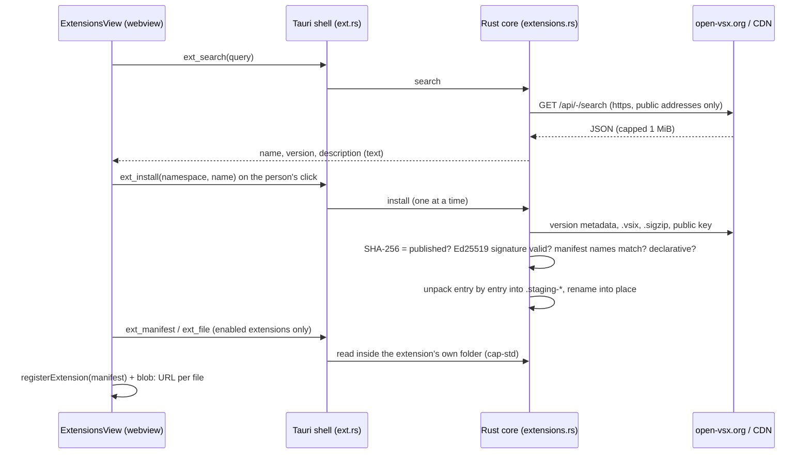
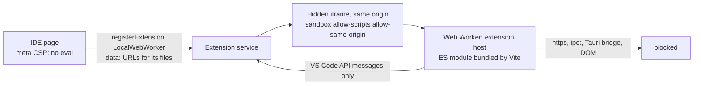

# Extensions from Open VSX (phases I6a and I6b)

* **Status:** I6a (declarative extensions) and I6b (web extensions) built 2026-11-21, see [ROADMAP.md](../ROADMAP.md). Requested by Pheonix ("finish the IDE and
  check off its roadmap"). Decision D1 of ADR-029 (P2P-AI repository): VS Code extensions come from Open VSX only.
* **Code:** `core/src/extensions.rs` (search, verified install, store), `app/src-tauri/src/ext.rs` (commands),
  `app/src/extensions.ts` (hands files to the editor), `app/src/components/ExtensionsView.tsx` (the view),
  `app/src/monaco.ts` (editor services and the web worker extension host), `app/vite.config.ts` (the page's own CSP).

## 1. Overview

The Extensions view (the blocks icon in the activity bar) lets people add VS Code extensions from
[Open VSX](https://open-vsx.org), the registry VSCodium uses. Phase I6a covers extensions that only contribute files:

* **Colour themes** and **icon themes** (for example Dracula, One Dark Pro, Material Theme).
* **Language grammars** (TextMate), **snippets** and **language settings** (comments, brackets, indentation).

Phase I6b adds **web extensions**: extensions with a `browser` entry (VS Code for the web runs the same ones), such as
many formatters, snippets with logic, hover and completion providers, and language support written for vscode.dev.
Their code runs in VS Code's **web worker extension host**, a Web Worker inside a hidden, sandboxed iframe, where it
can use the VS Code API for the files open in the editor but has **no network, no Node, no access to other files and
no Tauri commands** (decision card on I6b permissions: "Editor only, no network" was the recommended option and is
what is built; it can be changed if Pheonix picks otherwise).

Extensions with only Node code (a `main` entry and no `browser` entry: most language servers, linters, Git tools)
are refused with a message naming phase I6c (Node host). Web extensions that ask for proposed VS Code APIs
(`enabledApiProposals`) are refused, because those APIs are unstable and not offered.

To make this possible the editor moved from plain `monaco-editor` to `@codingame/monaco-vscode-api`, which is VS Code's
own editor services packaged for the web. The IDE now:

* colours code with VS Code's **TextMate grammars** (the same colours as VS Code) for about 20 built-in languages;
* opens with VS Code's **Dark Modern** theme and offers Light Modern and every installed theme;
* registers installed extensions exactly as VS Code registers its built-in ones.

## 2. How it works

| Command | Arguments | Returns |
|---|---|---|
| `ext_search` | `query` (1-100 characters), `offset` | up to 20 results: namespace, name, version, display name, description, downloads |
| `ext_install` | `namespace`, `name`, `version` (`latest` or an exact version) | the installed entry |
| `ext_list` | none | every installed extension |
| `ext_set_enabled` | `id`, `enabled` | the entry |
| `ext_uninstall` | `id` | nothing |
| `ext_manifest` | `id` | `package.json` of an enabled extension |
| `ext_file` | `id`, `path` | the file's bytes (raw IPC response, not JSON) |

The webview keeps one registration per enabled extension (`syncExtensions`). Turning an extension off or removing it
unregisters it and revokes its `blob:` URLs. If the theme in use belongs to that extension, the view first switches
back to Dark Modern and waits until the editor shows it.

### Web extensions (I6b)

* `monaco.ts` turns on the worker host (`enableWorkerExtensionHost`) and serves its bundled worker
  (`extensionHost.worker?worker&url`) as an ES module (`getWorkerOptions` returns `type: "module"`). The package
  emits its iframe page (`webWorkerExtensionHostIframe-*.html`) into `dist/assets/`.
* `extensions.ts` registers a web extension with `ExtensionHostKind.LocalWebWorker` (never the Node host). The
  `browser` entry file (with `.js` added when it has no extension, as VS Code does) and the contributed files become
  `data:` URLs, because the iframe's own CSP allows `data:` but not `blob:` for fetches.
* The worker fetches the entry and runs it with `new Function` (VS Code's CommonJS loader for web extensions), so the
  documents that host it need `'unsafe-eval'`; see the CSP below.
* An activated extension can't be dropped while its host runs (VS Code's rule), so turning a web extension off or
  removing it stops the extension hosts, unregisters it and starts them again: its code, providers and timers go away
  with the old worker.

## 3. How it is secure

Threat model (STRIDE): the registry, the CDN and every extension author are untrusted. A hostile or compromised
extension could try to run code, escape its folder on disk (zip slip), exhaust memory or disk (zip bomb), or carry
markup into the page. A network attacker could swap the download.

| Threat | Control | Standard |
|---|---|---|
| Swapped or corrupted download | SHA-256 must equal the value Open VSX publishes, **and** the Ed25519 signature in the `.sigzip` must verify with the public key Open VSX publishes for that version; unsigned extensions are refused | NIST SI-7, SSDF PS.2, CWE-494 |
| Wrong package under a trusted name | `publisher` and `name` in the manifest must equal what was asked for | CWE-345 |
| Node code from an extension runs | Node-only extensions (`main`, no `browser`) are refused at install; the webview checks again and never registers one, and never uses the Node (LocalProcess) host | CWE-94, NIST CM-7 |
| A web extension reaches the network or the computer (I6b) | Its code runs only in a Web Worker in a sandboxed iframe; the policies of the app CSP and the iframe's own CSP both apply, so `connect-src` is only `'self' data:`: https, `ipc:` and `http://ipc.localhost` are blocked; a worker has no DOM and no Tauri bridge. The UI test proves each from inside a running extension | NIST SC-7, AC-4, CWE-918 |
| A web extension opens a link to leak data | `vscode.env.openExternal` is refused and no window opens (UI test) | CWE-201 |
| Eval in the IDE page | `'unsafe-eval'` is in the header CSP only for the iframe's sake; the page's own meta CSP (built from the same string without it) takes it away again. The UI test checks a string timer does not run in the page | CWE-95, ASVS V14.4 |
| Unstable proposed APIs | Web extensions with `enabledApiProposals` are refused at install | CWE-693 |
| A removed extension keeps running | Turning off or removing restarts the worker host without it (UI test) | NIST CM-7 |
| Zip slip, links | Only `extension/` entries; every path part allow-listed (no `..`, absolute or drive paths, backslashes, control characters); links never created; writes through a cap-std handle | CWE-22, CWE-59 |
| Zip bomb, huge answers | At most 10,000 files, 50 MiB each, 300 MiB total, counted on bytes actually read; caps on metadata 1 MiB, `.vsix` 50 MiB, signature 1 MiB, key 4 KiB | CWE-409, CWE-400 |
| SSRF, open redirect | https only, Mozilla roots, no proxy from the environment, public addresses only; at most one redirect, only to `open-vsx.org` or `openvsx.eclipsecontent.org`; no user info or port in the host | CWE-918, CWE-601 |
| Markup from the registry | Names and descriptions are rendered by React as text (UI test injects an ``) | CWE-79, ASVS V5.3 |
| Reading other files | `ext_file` serves only enabled extensions and only paths inside their folder | CWE-22, deny by default |
| Installs without consent | Only the Install button calls `ext_install`; one install at a time | NIST AC-3, CWE-400 |
| Error details leak | Fixed messages per error kind | CWE-209 |
| Audit | `extension install_started / installed / refused <kind> / enabled / disabled / removed`, fixed words and the allow-listed id only | NIST AU-2, AU-3, CWE-117 |

Content-Security-Policy changes ([configuration/tauri-conf.md](../configuration/tauri-conf.md)):
`'wasm-unsafe-eval'` in `script-src` (WebAssembly compilation for the TextMate regex engine, not JavaScript `eval`);
`'self' data: blob:` in `connect-src` and `blob:` in `img-src`/`font-src` (files made inside the page). No remote host
was added: the page still cannot reach the network.

I6b changes: `'unsafe-eval'` and the hash of the iframe's one inline script (`'sha256-2EBQn…'`, monaco-vscode-api
39.0.5) in `script-src`, `frame-src 'self'`, and `frame-ancestors 'self'` (was `'none'`) so the app can frame its
own iframe page; other sites still can't frame the app. The IDE page gets a stricter `<meta>` CSP without
`'unsafe-eval'` (`vite.config.ts`, build only). A browser applies every policy a document has, so eval is possible
only in the extension host iframe and its worker, whose own CSP has no `ipc:` and whose intersection with the app CSP
has no remote host.

Licences: `@codingame/monaco-vscode-api` depends on `jschardet` (LGPL-2.1+), which VS Code uses to guess file
encodings. The IDE never opens files through VS Code's file service, so an npm override replaces it with a stand-in
([files/jschardet-stub.md](../files/jschardet-stub.md)); every shipped package stays on the licence allow-list.

## 4. How to use it

1. Click the **Extensions** icon (blocks) in the activity bar.
2. Type a search, for example `dracula`, and press Enter.
3. Click **Install** on a result. The IDE downloads it, checks the hash and signature, and lists it under
   **Installed** (a badge marks a verified publisher).
4. Pick the theme under **Colour theme**. The choice is remembered.
5. Use **On** to turn an extension off without removing it, or the bin icon to remove it.

A web extension is listed with "web extension (runs in the editor sandbox, no network)" and starts when the editor
needs it (its activation events, for example opening a file of its language).

An extension with only Node code shows, for example: "this extension runs Node.js code; the Node extension host
arrives in phase I6c".

## 5. Dependencies

| Name | Version | Purpose | CVE check |
|---|---|---|---|
| `@codingame/monaco-vscode-api` and its `-editor-api`, extensions, textmate, theme, languages and configuration service overrides | 39.0.5 (exact) | VS Code's editor services for the web | `npm audit` via `scripts/npm_audit_gate.py app`, 2026-11-21: passed |
| `@codingame/monaco-vscode-*-default-extension` (theme-defaults and 19 languages) | 39.0.5 (exact) | Built-in themes and grammars | same |
| `dompurify` (override) | 3.4.18 | Used by the editor services' markdown rendering; replaces the old patched copy | same |
| `zip` | 9.8.1, only `deflate-flate2` | Reads `.vsix` archives | `cargo audit` 2026-11-21: no advisories (2026-11-21_173522Z_security-scan_848b60e) |
| `flate2` | 1.1.11, `rust_backend` | Pure-Rust deflate for `zip` | same scan: no advisories |
| `ureq`, `sha2`, `ed25519-dalek`, `base64`, `cap-std` | unchanged | Already used by the core | unchanged |

## 6. Limitations and known risks

* Node extensions (most language servers, linters, Git tools) wait for I6c.
* A web extension sees and can change the text of files open in the editor, as any editor extension does (that is
  how formatters work). It has no network to send them anywhere, but a hostile one could change an open file's
  text; the person still saves and reviews changes. Only install extensions you trust.
* A web extension can fetch the IDE's own bundled files (`'self'`); they are public and read-only.
* A web extension that needs the network (for example one that calls an online service) will fail its requests.
* The iframe hash pins monaco-vscode-api 39.0.5: an upgrade that changes the iframe page needs the new hash (the UI
  smoke test fails with a CSP report if it is missing).
* Checked in headless Chromium with the shipped CSP. Still to check on the PC: WebView2 (Windows) and WebKitGTK
  in the real desktop app, with a live install of a web extension from open-vsx.org.
* Open VSX is trusted to publish the right hash and key. A compromise of open-vsx.org itself would pass the check;
  the verified-publisher badge and the person's choice are the remaining controls.
* Extensions are not updated automatically; installing again replaces the old copy.
* Product icon themes and localisation packs are accepted by the core but not tested in this phase.

## 7. Troubleshooting

| Message | Cause | Fix |
|---|---|---|
| "Open VSX could not be reached or refused the request" | No internet, a firewall, or a proxy (the IDE does not use system proxies) | Check the connection; proxies are not supported yet |
| "the extension has no valid Open VSX signature; nothing was installed" | Unsigned extension, or a changed file | Choose another extension; report it to Open VSX if it should be signed |
| "... runs Node.js code ..." | A Node-only extension | Waits for I6c |
| "this extension uses proposed VS Code APIs, which the IDE does not offer; nothing was installed" | `enabledApiProposals` in its manifest | Choose another extension |
| A web extension does nothing | It needs the network or a Node API, or its activation event has not happened | Open a file of its language; extensions that need the network can't work here |
| "another extension is being installed; wait for it to finish" | One install at a time | Wait for the first one |
| Theme does not change | The extension was turned off | Turn it on again |

## 8. Test evidence

* Core unit tests with 9 new extension tests: [2026-11-21_173347Z_core_848b60e](../HistoryTest/runs/2026-11-21_173347Z_core_848b60e/RUN.md).
* Real install path on Open VSX files cached with curl (Dracula 2.25.1 installed with a verified signature;
  material-icon-theme and redhat.vscode-yaml refused as Node extensions): [2026-11-21_173357Z_ovsx-cached_848b60e](../HistoryTest/runs/2026-11-21_173357Z_ovsx-cached_848b60e/RUN.md).
* UI smoke test, 87 of 87 (search results as text, refused code extension, install, theme switch, removing the theme
  in use): [2026-11-21_173412Z_ui_848b60e](../HistoryTest/runs/2026-11-21_173412Z_ui_848b60e/RUN.md).
* Static checks and scans: [2026-11-21_173522Z_security-scan_848b60e](../HistoryTest/runs/2026-11-21_173522Z_security-scan_848b60e/RUN.md).
* Not yet run: a live install from open-vsx.org on the PC (the cloud container reaches the internet only through a
  proxy, which the IDE's client deliberately does not use).
* Phase I6b: core unit tests 83 passed [2026-11-21_215005Z_core_fd65ba7](../HistoryTest/runs/2026-11-21_215005Z_core_fd65ba7/RUN.md); UI smoke test 98 of 98 with the web
  extension checks (runs in the worker, hover shows; https, `ipc:`, Tauri bridge, DOM and links blocked; page
  can't eval; removal stops its code) [2026-11-21_215016Z_ui_fd65ba7](../HistoryTest/runs/2026-11-21_215016Z_ui_fd65ba7/RUN.md); app unit tests
  [2026-11-21_215028Z_app-unit_fd65ba7](../HistoryTest/runs/2026-11-21_215028Z_app-unit_fd65ba7/RUN.md); static checks and scans [2026-11-21_215028Z_security-scan_fd65ba7](../HistoryTest/runs/2026-11-21_215028Z_security-scan_fd65ba7/RUN.md).
