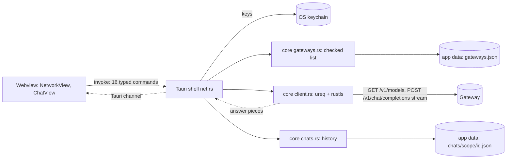

# Gateways and chat (phase I2a)

* **Status:** built 2026-11-17 on PR #1's branch, after phase I1. Phase I2 of the IDE plan in the P2P-AI repository
  (`docs/restructure/agentic-ide-plan.md` section 5, ADR-029 D4: one key per gateway). Requested by Pheonix ("keep
  moving forward", 2026-11-17).
* **Code:** `core/src/{gateways,client,chats,store}.rs`, `app/src-tauri/src/net.rs`,
  `app/src/components/{NetworkView,ChatView}.tsx`, `app/src/ipc.ts`.
* **Next:** I2b, the public gateway list from signed directory adverts, is done: [public-gateways.md](public-gateways.md).
  I3 gives the chat its tools (read, search, patch) with diff review.

## 1. Overview

The IDE can now talk to P2P-AI gateways:

* **Gateways view** (the network icon): add the gateway set up on this computer (pick its setup folder; the IDE reads
  the port and the stack's CA from it) or any gateway by its address. Paste the key you were given; it goes to the
  system keychain. Pick the active gateway, **Check** it (latency and model count), pin a CA file for a private
  gateway, replace the key, or remove the gateway (two clicks).
* **Agent chat** (the speech-bubble icon): choose a model from the active gateway, write a message (Ctrl+Enter
  sends), watch the answer stream in, press **Stop** to end it. In this phase the model only sees what you type; it
  cannot read or change files yet (phase I3).
* **History**: every chat is saved on this computer, per open folder. The clock button lists them; search finds
  chats by any text in them; a chat is deleted with two clicks.
* **Status bar**: the left chip names the active gateway and opens the Gateways view. A plain-http test gateway on
  this computer shows **INSECURE — DEV ONLY**.

## 2. How it works

| Command | Arguments | Returns |
|---|---|---|
| `gateways_list` | none | `{gateways: [{id, name, url, kind, dev, pinned, has_key}], active}` |
| `gateway_add` | `name`, `url`, `key` (optional) | new id |
| `gateway_add_local` | `name`, `key` (optional); setup folder from the OS dialog | new id, or null when cancelled |
| `gateway_pick_ca` / `gateway_clear_ca` | `id`; CA file from the OS dialog | picked or not |
| `gateway_set_key`, `gateway_remove`, `gateway_set_active` | `id` (+ `key`) | nothing |
| `gateway_check` | `id` | `{latency_ms, models}` |
| `chat_send` | `model`, `messages: [{role, content}]`, `onEvent` channel | `{finish_reason, chars}`; pieces arrive as `{kind: "delta", text}` |
| `chat_stop` | none | nothing |
| `chats_list`, `chat_load`, `chat_save`, `chat_delete`, `chats_search` | id, chat or query | summaries, a chat, hits |

The gateway API used is the OpenAI-style one every P2P-AI gateway serves: `GET /v1/models` and
`POST /v1/chat/completions` with `stream: true` (server-sent `chat.completion.chunk` events, ending with
`data: [DONE]`), authorised with `Authorization: Bearer <key>`.

Saved files are described in [files/app-data.md](../files/app-data.md).

## 3. How it is secure

Threat model (STRIDE, brief). Assets: gateway keys, chat history (may contain private code). Attackers: a hostile
or spoofed gateway, a hostile answer (prompt injection, markup), another local user, a compromised webview.

| Threat | Control | Reference |
|---|---|---|
| Key theft from files or logs | keys only in the OS keychain (Credential Manager, Keychain, Secret Service); never in `gateways.json`, never returned to the webview (`has_key` only), never logged or in error text; the client's `Debug` hides it; the key field is cleared after sending | CWE-522, CWE-532, NIST IA-5 |
| Key sent to the wrong host | URL allow-list (`https://host[:port]` only, no user info or path); no redirects followed; no proxy from the environment | CWE-601, CWE-918, NIST SC-8 |
| Spoofed gateway / interception | TLS always on except a loopback `http://127.0.0.1` dev gateway (badged INSECURE — DEV ONLY); a pinned CA is the only trust root for that gateway; otherwise Mozilla roots | CWE-295, NIST SC-8, SC-13 |
| Admin powers in the IDE | the local-gateway import reads only `.env` (port) and `tls/ca/ca.pem`, never `secrets/` | NIST AC-6 |
| Hostile answer (XSS, prompt injection) | answers are text: React text nodes and `<pre>` only, no HTML or Markdown-to-HTML, links not clickable; nothing in an answer is run; the model has no tools in I2 | CWE-79, OWASP LLM01 |
| Header injection via key or model | keys and model ids are visible ASCII only, no spaces | CWE-113 |
| Path tricks through ids | chat and gateway ids are 16 hex characters; history scope is a hash of the folder path | CWE-22, CWE-73 |
| Other local users reading history | files 0600 and folders 0700 on Unix; the per-user app-data folder on Windows | CWE-276, CWE-200 |
| Resource exhaustion | request 2 MiB / 200 messages; answer 8 MiB, 1 MiB per event line; 10 min per turn, Stop; one turn at a time; 32 gateways; 500 chats, 4 MiB each; plain-substring history search | CWE-400, CWE-770, CWE-1333 |
| Damaged or edited state files | `gateways.json` and every chat are re-checked on load; bad entries refuse the file or are skipped | CWE-20 |
| Error details leaking | fixed messages per error kind, HTTP status at most | CWE-209 |
| Missing audit trail | stderr lines with a timestamp and fixed words: gateway added/removed, key set, CA pinned, chat sent, refusals | NIST AU-3, CWE-117 |

## 4. How to use it

1. Get a key from the gateway's operator (in the P2P-AI desktop app: Gateway view, Keys, **Create**).
2. Open the **Gateways** view, **Add gateway**:
   * the gateway on this computer: **This computer's gateway...**, then choose its setup folder (the folder you ran
     Set up in); or
   * any gateway: name, address such as `https://gateway.example.org`, the key, **Add by address**. For a gateway with
     its own CA, press **Pin CA** and choose the CA file.
3. Press **Check**: you should see something like `35 ms, 4 models`.
4. Open **Agent chat**, pick a model, type, press Ctrl+Enter.
5. The clock button shows this folder's history; type in **Search chats** and press Enter to search.

Developer gateway without TLS: `http://127.0.0.1:8080` is accepted and marked INSECURE — DEV ONLY. Never use it for
real keys.

TandemForge on this computer (phase I7) is a third kind of entry, added with **Pair with TandemForge** instead of
**Add gateway**; see [tandemforge-engine.md](tandemforge-engine.md).

## 5. Dependencies

| Name | Version | Purpose | CVE check |
|---|---|---|---|
| ureq | 3.5.2 (rustls, ring, webpki-roots; no gzip) | HTTPS client in the core | cargo audit 2026-11-17: no advisories |
| serde_json | 1.0.154 | saved files, gateway answers | cargo audit 2026-11-17: no advisories |
| keyring | 4.2.0 (default `v1` stores) | OS keychain | cargo audit 2026-11-17: no vulnerabilities; on Linux its Secret Service store pulls zbus 5, whose `zvariant`, `zvariant_derive`, `zbus_names` are flagged unmaintained (RUSTSEC-2026-0370/0371/0372, informational; accepted, see SECURITY-LOG) |

## 6. Limitations and known risks

* No email sign-in (D4 later option). The public gateway list is in [public-gateways.md](public-gateways.md).
* No proxy support: the IDE connects directly. People behind a company proxy cannot reach outside gateways yet.
* On Linux the keychain needs a running Secret Service (GNOME Keyring or KWallet). Without it, adding a key fails
  with "the system keychain could not store or read the key".
* The key passes once from the webview to Rust over Tauri's IPC when you type it. A compromised webview could read
  what you type; the strict CSP and text-only rendering are the controls against that.
* Answers are shown as plain text; Markdown is not formatted except code fences.
* History is per folder by its path: moving a folder starts a new history.

## 7. Troubleshooting

| Message | Cause and fix |
|---|---|
| "use https://host[:port] ..." | the address has a path, query or user name, or is plain http to another computer |
| "this gateway has no key yet" | press **Add key** on the gateway |
| "the gateway refused the key" | wrong or revoked key; ask the operator for a new one |
| "the gateway's certificate is not trusted" | a private gateway: **Pin CA** with its CA file |
| "could not reach the gateway" | address or port wrong, gateway down, or a proxy is required |
| "the system keychain could not store or read the key" | Linux: start GNOME Keyring or KWallet |
| "that folder has no gateway setup" | pick the folder where the desktop app ran Set up (it has `.env` and `tls/ca/ca.pem`) |

## 8. Test evidence

* [Core: fmt, clippy, 31 tests incl. a loopback fake gateway](../../HistoryTest/runs/2026-11-17_062006Z_core_bd2763f/RUN.md)
* [Tauri shell: fmt and clippy with net.rs and keyring](../../HistoryTest/runs/2026-11-17_062007Z_shell_bd2763f/RUN.md)
* [Webview: type check, 4 unit tests, build, UI smoke 30/30 with gateways and chat](../../HistoryTest/runs/2026-11-17_062008Z_ui-smoke_bd2763f/RUN.md)
* [cargo audit of both lockfiles: 0 vulnerabilities, 5 unmaintained warnings (accepted)](../../HistoryTest/runs/2026-11-17_062016Z_security-scan_bd2763f/RUN.md)
* [Windows PC: build, 29 core tests, release exe (click-through still to do)](../../HistoryTest/runs/2026-11-17_061800Z_windows_71a1e22/RUN.md)
