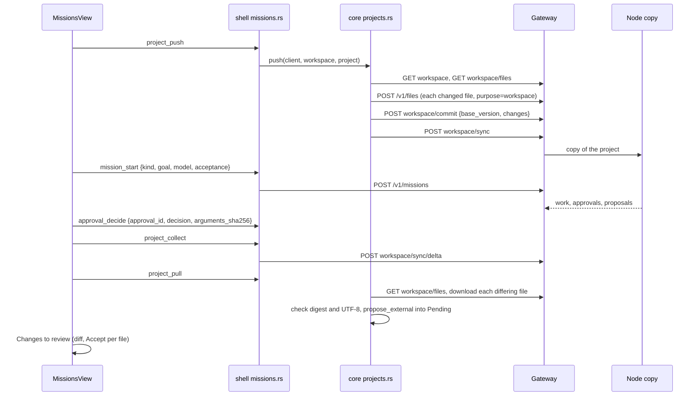

# Missions: Autopilot and Auto Improve from the IDE (phase I4)

* **Status:** built 2026-11-17 after phase I3 was merged (PR #3). Phase I4 of the IDE plan in the P2P-AI repository
  (`docs/restructure/agentic-ide-plan.md`, ADR-029 D3: missions run on the gateway, returned work goes through the
  same review as chat edits). Requested by Pheonix ("keep moving forward with the rest", 2026-11-17).
* **Code:** `core/src/gwapi.rs`, `core/src/projects.rs`, `core/src/agent.rs` (`propose_external`),
  `core/src/workspace.rs` (`all_files`, `read_bytes`), `app/src-tauri/src/missions.rs`,
  `app/src/components/MissionsView.tsx`, `app/src/{App.tsx,ipc.ts}`, `app/src/components/{ChatView,StatusBar}.tsx`.
* **Tests:** `core/tests/projects.rs` (fake gateway on 127.0.0.1), `core/examples/live_missions.rs` with `scripts/live_gateway_e2e.py` (real gateway), unit tests in `gwapi.rs` and `projects.rs`,
  `app/tests/ui-smoke.mjs` (Missions flow).
* **Next:** I5 shipped (#7, #9 to #12); see [ROADMAP.md](../ROADMAP.md) for I6 extensions and I7.

## 1. Overview

A mission is long work the gateway does on a copy of the project: **Autopilot** works toward a goal the person
writes and checks it with tests or commands; **Auto Improve** looks for improvements and offers them as proposals.
The **Missions** view (rocket icon) lets the person:

1. link the open folder to a project on the active gateway (pick one or create one);
2. **Send folder to the project** (only changed files are sent; secrets stay on the computer);
3. switch **Autopilot** and **Auto Improve** on or off for the project (the project owner only);
4. start a mission with a goal, a model and 1 to 8 acceptance checks, then Pause, Resume or Stop it;
5. decide the mission's approval requests (Approve or Reject, with the exact arguments shown);
6. Accept, Dismiss or Snooze Auto Improve proposals;
7. **Bring the work back**: collect the node copy's changes into the project, then **Review changes**, which puts
   each changed file into the same **Changes to review** list and diff as chat edits. Nothing is written until the
   person presses Accept on each file.

The status bar's **Autopilot** and **Auto Improve** chips show whether each is on for the linked project and open
the Missions view.

## 2. How it works

* **Gateway API:** the P2P-AI project, workspace, files, missions, approvals and proposals routes
  (`/v1/projects`, `/v1/projects/{id}/workspace[/files|/commit|/sync|/sync/delta]`, `/v1/files`,
  `/v1/experimental`, `/v1/projects/{id}/experimental`, `/v1/missions[/{id}[/pause|resume|stop]]`,
  `/v1/agents/runs/{run}/approvals`, `/v1/projects/{id}/proposals[/{pid}/accept|dismiss|snooze]`).
* **Push:** reads the project's version and file list (path, size, SHA-256), hashes the eligible local files, uploads
  those whose SHA-256 differs, and commits all changes with `base_version` in chunks of at most 1000. Files deleted
  locally are deleted on the gateway; files the IDE refuses to send are never deleted there. Each file is read and
  hashed again just before upload, so a file changed meanwhile is skipped ("changed while sending; push again").
  Quarantined uploads (malware scan) are waited on for up to 60 seconds. Then the copy to a node is requested; when the
  gateway has that off, the report says the copy is "off".
* **Pull:** compares the gateway's list with the folder; each differing text file is downloaded, its SHA-256 checked
  against the list, and handed to `propose_external`, which refuses denied names and files changed locally since the
  pull was planned. Files only on this computer are counted, never deleted (no delete-back).
* **Folder links:** `links.json` in the app data folder maps a folder (by a hash of its path) and a gateway to a
  project; see [files/app-data.md](../files/app-data.md).
* **Errors:** the gateway's `error.code` is mapped to a fixed message (`gwapi::code_message`); the gateway's own
  message text is never shown.

| Command | Arguments | Returns |
|---|---|---|
| `mission_project` | none | `{folder, gateway, linked project or null, switches}` |
| `projects_list` | none | `[{id, name, role}]` |
| `project_create` | `name` | the project, and links it |
| `project_link` | `projectId` (or null to unlink), `projectName` | nothing |
| `project_push` | none | `{uploaded, deleted, unchanged, skipped[], version, copy}` |
| `project_collect` | none | sync state `{state, version, delta}` |
| `project_pull` | none | `{proposed, same, only_local, skipped[]}` |
| `switches_set` | `autopilot`, `autoImprove` | switches |
| `missions_list` / `mission_get` | none / `id` | missions of the linked project / one with tasks and checks |
| `mission_start` | `kind`, `goal`, `model`, `checks[]` | the mission |
| `mission_control` | `id`, `action` (`pause`, `resume`, `stop`) | nothing |
| `approvals_list` / `approval_decide` | `runId` / `runId`, `approvalId`, `decision`, `argumentsSha256` | approvals / nothing |
| `proposals_list` / `proposal_act` | none / `id`, `action` (`accept`, `dismiss`, `snooze`) | proposals / nothing |

## 3. How it is secure

Threat model (STRIDE, brief). Assets: the person's code and secrets in the folder, the integrity of local files, the
person's gateway key and project. Attackers: a hostile or compromised gateway, a mission or model that went wrong or
was prompt-injected, another writer on the same project, hostile text in gateway answers.

| Threat | Control | Reference |
|---|---|---|
| Secrets in the folder sent to the gateway | the agent deny list (`.env`, keys, certificates, credential files, `.git/`, `.ssh/`, `.aws/`, `secrets/` and others) applies to push; denied files are listed as "kept on this computer"; build and dependency folders (`node_modules`, `target`, ...) and symlinks are skipped | CWE-200, CWE-538, CWE-59 |
| A mission or gateway plants or changes local files | pull never writes: every file becomes a pending change shown in the diff and written only on Accept, with the editor's version check; denied names (`.env`, ...) are never fetched; binary files are not brought back | OWASP LLM06, NIST AC-6, CWE-73 |
| Tampered or swapped download | the downloaded bytes must match the SHA-256 the gateway listed; a mismatch is refused | CWE-345, CWE-494 |
| Lost update on the gateway | every commit carries `base_version`; a project changed meanwhile is refused (409), never overwritten | CWE-362, CWE-367 |
| Lost update locally | `propose_external` checks the local version the pull was planned against; accept checks it again | CWE-367 |
| Approving something other than what was shown | the decision carries the SHA-256 of the arguments the person saw; the gateway refuses it if they changed | CWE-345, OWASP LLM06 |
| Path tricks from gateway paths | gateway paths pass an ASCII grammar (no `..`, absolute paths, backslashes, Windows device names, trailing dot or space) and then the workspace's own confinement | CWE-22, CWE-73 |
| Request forgery to other hosts | `Client::api` only takes `/v1/` paths on the active gateway; ids are allow-listed; file paths are percent-encoded | CWE-918, CWE-20 |
| Upload smuggling | multipart file names pass an allow-list; the boundary is random and checked not to occur in the file | CWE-93, CWE-20 |
| Resource exhaustion | 2000 files, 5 MiB per file and 100 MiB per push; 50 files per pull; 1000 changes per commit; 2 MiB answers, 1 MiB request bodies, 5 MiB downloads; 64 KiB approval arguments; 200 folder links; one send, collect or pull at a time | CWE-400, CWE-770 |
| Hostile text in the UI | names, goals, task titles, approval arguments and proposal sources are React text (arguments in a `<pre>`); proposal sources are not links | CWE-79 |
| Gateway error text in the UI or logs | fixed messages by error code; fixed audit words only (project created, folder pushed, changes pulled, switches set, mission started, mission control, approval decided, proposal triaged); no paths, goals or ids | NIST AU-3, CWE-117, CWE-532, CWE-209 |
| Authorization | the gateway checks the key and project role on every call (only the owner switches Autopilot); the IDE shows the refusal | NIST AC-3 |

## 4. How to use it

1. Open a folder. In **Gateways**, make a gateway with a key active.
2. Open **Missions** (rocket icon). Pick a project from the list, or type a name and press **Create project**.
3. Press **Send folder to the project**. The summary shows how many files were sent, deleted, unchanged, and a
   list of files kept on this computer and why.
4. Tick **Autopilot** (and **Auto Improve** if wanted). Only the project owner can change these.
5. Under **Start a mission**: pick Autopilot or Auto Improve, write the goal (for example
   `make the tests in tests/ pass`), pick a model, and add checks, for example a `pytest` tests check, or a command
   check such as `python -m pytest -q` split into words. Press **Start**.
6. Watch the mission. **Review approval** shows what the mission wants to run, with the exact arguments; press
   **Approve** or **Reject**. **Pause**, **Resume**, or **Stop** (press twice: "Stop for good").
7. When it is done, press **Collect changes**, then **Review changes**. The Agent chat opens with the files under
   **Changes to review**; open each diff and **Accept and save** or **Reject**.

## 5. Dependencies

No new dependencies. Uses ureq, serde, serde_json and sha2 in core (already pinned) and the existing React UI.
cargo audit (core 71 crates, shell 529 crates) and npm audit on 2026-11-17: 0 vulnerabilities (run linked below).

## 6. Limitations and known risks

* **The folder's contents go to the gateway.** Everything not on the deny list is uploaded to the chosen gateway and
  copied to a node to run the mission. A secret in an ordinary file (for example a key pasted into `config.py`) is
  sent. Use a gateway you trust, and keep secrets out of the code folder. (Accepted risk, SECURITY-LOG.)
* The gateway's upload allow-list may refuse some file types; they are listed as skipped and stay local only.
* Deleted files are not brought back as deletions: files only on this computer are counted ("only here").
* Binary files changed by a mission are not brought back; get them from the gateway's web app.
* A new file in a folder that does not exist locally fails at Accept; create the folder first.
* Autopilot needs the node copy; a gateway with workspace sync off reports the copy as "off", and missions that need
  it cannot work on the code.
* The node copy runs code from the project in the node's sandbox; this is the gateway's control, not the IDE's.
* Pending changes stay in memory only: closing the app drops them (pull again).
* The live check uses a scripted model; a run with a real model depends on that model's tool use.

## 7. Troubleshooting

| Message | Cause and fix |
|---|---|
| "link this folder to a gateway project first" | pick or create a project in the Missions view |
| "the gateway project changed meanwhile; try again" | someone else (or a mission) committed; send again |
| "a file is still being scanned on the gateway; try again shortly" | the malware scan took over 60 s; send again |
| "the gateway does not accept this file type" | the gateway's upload allow-list; the file stays local |
| "no node holds a copy of this project yet; send the folder first" | send the folder, then collect |
| "the project owner has not switched this on for the project" | the owner ticks Autopilot or Auto Improve |
| "this gateway does not run code for your key, so Autopilot is not available" | ask the gateway's administrator |
| "the approval changed; open it again" | the arguments changed after you opened it; review again |
| "could not be added for review (changed locally, or too many waiting)" | the file was edited locally after the pull was planned, or 50 changes wait; review those and pull again |
| "a send or pull is still running" | wait for the running one to finish |

## 8. Test evidence

* [Core: fmt, clippy, 53 unit + 5 discovery + 2 projects tests (push without secrets, pull for review, digest check, version conflict)](../../HistoryTest/runs/2026-11-17_082336Z_core_7e32c2d/RUN.md)
* [Tauri shell: fmt and clippy with the 16 missions commands](../../HistoryTest/runs/2026-11-17_082340Z_shell_7e32c2d/RUN.md)
* [Webview: UI smoke 57/57 with the Missions flow (link, send, switches, start, approval as text, stop twice, collect, review)](../../HistoryTest/runs/2026-11-17_082340Z_ui-smoke_7e32c2d/RUN.md)
* [cargo audit and npm audit: 0 vulnerabilities](../../HistoryTest/runs/2026-11-17_082359Z_security-scan_7e32c2d/RUN.md)
* [Live: the IDE core against a real Go gateway, node and sandbox, Autopilot mission end to end: 19 passed, 0 failed](../../HistoryTest/runs/2026-11-17_085225Z_live-gateway_bfae51f/RUN.md) ([commands/live-gateway-e2e.md](../commands/live-gateway-e2e.md))
* [Windows build and tests at bfae51f: every step passes (core 58 tests, npm audit 0, release build); PC click-through not done](../../HistoryTest/runs/2026-11-17_085943Z_windows_bfae51f/RUN.md)
