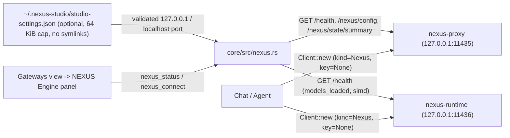

# NEXUS Engine on this computer

The IDE discovers and connects to local **NEXUS Engine** services running on `127.0.0.1` (`nexus-proxy` and `nexus-runtime`) directly from the **Gateways** view, with no API key required.

## 1. Purpose

NEXUS Engine provides local LLM middleware and native `.nexus` inference on loopback:

* **NEXUS Proxy (`nexus-proxy`, default `127.0.0.1:11435`)**: OpenAI-compatible `/v1/models` and `/v1/chat/completions` endpoint with deterministic KV-cache **Context Packer**, lossless **Data Airlock**, Failure Memory, Vision Airlock dedup, and full **Agent chat** tool-call forwarding (`list_dir`, `read_file`, `search`, `edit_file`, `create_file`, and approved runs).
* **NEXUS Runtime (`nexus-runtime`, default `127.0.0.1:11436`)**: Native zero-copy `.nexus` / Mamba-hybrid / Fourth Model Mode server providing `/v1/models` and `/v1/chat/completions` for **plain chat** (`Tools` off). `nexus-runtime` does not parse or emit OpenAI `tool_calls`.

## 2. How it works

1. **Discovery**: `nexus::discover_endpoints()` checks `~/.nexus-studio/studio-settings.json` (read via `store::read_capped` with symlinks refused) for valid `proxyUrl` / `runtimeUrl` loopback ports, falling back to `11435` (Proxy) and `11436` (Runtime). Custom loopback ports (`1024..=65535`) may also be entered in the **Custom local port** panel.
2. **Health verification**: `nexus::probe_endpoint()` sends `GET /health` with a 2 s timeout, no redirects, and no proxy, requiring `"status": "ok"` and matching `"service"` (`"nexus-proxy"` or `"nexus-runtime"`). For Proxy, it also fetches optional telemetry from `/nexus/config` and `/nexus/state/summary`. For Runtime, it reads `models_loaded`, `models_available`, and sanitizes `simd` to printable ASCII.
3. **Storage & Chat**: `GatewayStore::save_nexus()` saves a `Kind::Nexus` entry in `gateways.json` (Proxy and Runtime can both be saved side-by-side without duplicating existing role entries) and stores no keychain secret. `Client::new` permits `key = None` **only** when `kind == Kind::Nexus` and `nexus::is_engine_url(&gw.url)` holds, omitting the `Authorization` header.
4. **UI behavior**: `Kind::Nexus` entries show `local engine (no key needed)`, never carry the `INSECURE — DEV ONLY` banner, and hide key/CA/account controls. **Missions** displays clear local-engine guidance (since remote missions require a P2P-AI Go gateway). **Agent chat** shows an informative note when `NEXUS Runtime` is selected with `Tools` enabled.
5. **VS Code extension**: Command **P2P-AI: Connect NEXUS Engine** (`p2pAi.connectNexus`) provides the same loopback discovery, `/health` check, and keyless `GatewayClient` connection via [vscode-extension/src/nexus.ts](../../vscode-extension/src/nexus.ts).

## 3. How it is secure

| Threat | Control | Reference |
|---|---|---|
| SSRF / sending local chat off-box via tampered `studio-settings.json` or `gateways.json` | Strict `http://127.0.0.1:<port>` check (`1024..=65535`, no path/query/userinfo); `GatewayStore::open` refuses corrupted `kind: "nexus"` URLs; `Client::new` re-verifies before requests; no redirects (`max_redirects(0)`) and no env proxy | NIST SP 800-53 SC-7, CWE-918, CWE-601 |
| Symlink / DoS reading `~/.nexus-studio/studio-settings.json` or local probe responses | `store::read_capped` / `lstatSync` refuses symlinks; 64 KiB cap on settings and `/health` JSON; 2 s probe timeout | CWE-59, CWE-400 |
| Script / markup injection via malicious `simd` or model telemetry strings | Sanitized in Rust/TS and rendered strictly as React / DOM text | CWE-79 |
| Mistakenly allowing remote/manual gateways without credentials | `key = None` is rejected (`NetError::NoKey`) for every non-`Nexus` gateway kind, including manual loopback HTTP and TandemForge | CWE-287, NIST IA-5 |
| Linking a local engine to a remote P2P-AI account (sending bearer tokens locally) | `GatewayStore::set_account` and `GatewayStore::open` forbid `account` on `Kind::Nexus` | CWE-522 |
| Path or URL disclosure in error messages | Fixed `NexusError::message()` strings contain no filesystem paths or URLs | CWE-209 |

## 4. Note on Data Airlock and Agent tools

When using `nexus-proxy`, tool result messages (`role: "tool"`) exceeding `airlock_threshold` (default `250` tokens) are archived by NEXUS Proxy into SQLite and replaced upstream with a compact structural `[AIRLOCK artifact_id=...]` Concept Map. Using `read_file` with `start_line` / `end_line` ranges (or raising `airlock_threshold` via NEXUS Proxy config when full raw file slices are desired) lets models inspect exact code cleanly. `.env` and denied paths are still blocked in the IDE before any tool output is created.

## 5. Limitations

* Does not run remote P2P-AI Missions (Autopilot / Auto Improve); those require a P2P-AI Go gateway.
* Does not manage or spawn the `nexus-proxy` / `nexus-runtime` daemons itself; start NEXUS Engine via NEXUS Studio or CLI before connecting.

## 6. Test evidence

* [Core: fmt, clippy, 135 unit + 5 discovery + 2 project tests (2026-11-23)](../../HistoryTest/runs/2026-11-23_114345Z_core_dc07c54/RUN.md)
* [Live E2E against real `nexus-proxy` & `nexus-runtime` (`scripts/live_nexus_e2e.py`)](../../HistoryTest/runs/2026-11-23_114348Z_live-nexus_dc07c54/RUN.md)
* [Tauri shell clippy & tests (`nexus_status`, `nexus_connect`)](../../HistoryTest/runs/2026-11-23_114353Z_shell_dc07c54/RUN.md)
* [Playwright UI smoke suite (`ui-smoke.mjs`: 133/133 passed)](../../HistoryTest/runs/2026-11-23_114250Z_ui_dc07c54/RUN.md)
* [VS Code extension check & unit tests (48/48 passed)](../../HistoryTest/runs/2026-11-23_114356Z_vscode-ext-unit_dc07c54/RUN.md)
* [Supply-chain npm audit gate (`app` & `vscode-extension`)](../../HistoryTest/runs/2026-11-23_114426Z_security-scan_dc07c54/RUN.md)
