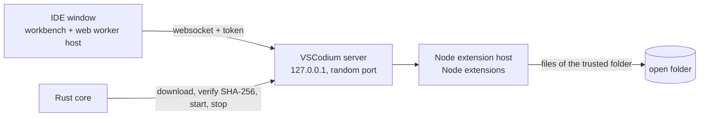

# Node extensions (phase I6c): design

Status: **accepted 2026-11-22, done for Windows x64 and Linux x64**. Pheonix first picked "VSCodium server, on first need" (option A). Because no VSCodium release matched the editor's VS Code version, Pheonix then chose to build our own server (I6c-4, section 7). I6c-1 (core), I6c-2 (editor), I6c-3 (PC fixes and version check) and I6c-4 (our 1.145.2 builds, pinned) are done. On 2026-11-22 a real Open VSX extension (Code Spell Checker) ran in the Windows desktop app. macOS and Linux arm64 wait for a builder.

## 1. Overview

Most popular VS Code extensions (language servers, linters, debuggers, formatters) are Node extensions: their `package.json` has a `main` entry and they call Node APIs (`fs`, `child_process`, `net`). The IDE refuses them today (I6b only runs `browser` entries in a sandboxed worker). ADR-029 D1 says Node extensions run in a separate sidecar process, with workspace trust, and with no gateway keys.

## 2. What we found

* `@codingame/monaco-vscode-api` (39.0.5, built on VS Code **1.145.2**, commit `c4453f8e`; the earlier note here said 1.140, which was wrong, see section 7) does **not** ship VS Code's Node extension host. Its only supported way to run Node extensions is a **VS Code server** ("remote extension host", REH) connected through `@codingame/monaco-vscode-remote-agent-service-override` (39.0.5 is on npm).
* The remote authority must be set when the editor services start (`initialize`); it can't be added later. So turning Node extensions on or off needs an editor reload.
* Node extensions only see files of a workspace folder that belongs to the server (`vscode-remote://` URIs). The IDE's open folder is served by the Rust core today with its own URIs, so the editor's models and the folder would move to the server's file system when Node extensions are on.
* Microsoft's VS Code server licence allows its use with Microsoft products only. **VSCodium** builds the same server from the MIT source (`vscodium-reh-<os>-<arch>-<version>.tar.gz` on its GitHub releases, about 85 MB, with Node inside). The release must match the workbench's VS Code minor version (1.145.x for 39.0.5); the IDE then sets the server's commit in its product configuration.
* Pinned on the PC 2026-11-22 (section 7): VSCodium 1.140.06880, VS Code commit `807ba2d6075c29587f884698cd7370c81ab0724c`, files `vscodium-reh-<os>-<arch>-1.140.06880.tar.gz` (85 MB for Windows).

## 3. Options

| Option | What runs Node extensions | Compatibility | Work |
|---|---|---|---|
| **A. VSCodium server, downloaded on first need (recommended)** | The VSCodium REH 1.140.x, started by the Rust core on `127.0.0.1` with a random connection token, only in a trusted folder | Same as VSCodium: almost every Open VSX Node extension | Large: download and verify, sidecar, remote workbench wiring, folder through the server; 3 PRs |
| B. Node.js alone and our own host | A small host we write, giving extensions part of the `vscode` API | Low: each API we don't write breaks extensions | Very large and never finished |
| C. Not now | Nothing; Node extensions stay refused | Web extensions only | None |

## 4. How option A works

1. Installing a Node extension is allowed again; the Extensions view says it needs the Node host and a trusted folder.
2. The first time a trusted folder has an enabled Node extension, the IDE asks once: "Download the Node extension host (about 85 MB)?" The core downloads the pinned VSCodium server for this OS and CPU from GitHub releases, checks the pinned SHA-256 (fail closed), and unpacks it into the app data folder (no paths outside it, no links).
3. The core starts the server with a scrubbed environment (no gateway keys, no tokens, a fixed `PATH`), `--host 127.0.0.1 --port 0`, a random connection token from the OS CSPRNG, extensions folder inside the app data, and telemetry off. The token goes to the window only.
4. The window reloads with the remote authority `127.0.0.1:<port>` and the folder as a `vscode-remote://` workspace folder. Web extensions keep running in the worker.
5. Closing the folder, losing trust, or quitting stops the server.

## 5. How it is secure

| Threat | Control |
|---|---|
| A tampered or swapped download (CWE-494, NIST SI-7, SA-12) | Exact version pinned per OS and CPU with SHA-256 in the repository; https only; refused on mismatch; unpack refuses `..`, absolute paths and links (CWE-22, CWE-59) |
| A hostile folder runs code on open (CWE-829) | Workspace trust: an untrusted folder starts no server; trust is asked per folder and stored by the core |
| Another local program drives the server (CWE-306, CWE-1327) | Bound to `127.0.0.1` only, random port, 192-bit connection token from the OS CSPRNG, never logged (CWE-532) |
| Node extensions read gateway keys (CWE-522) | Keys stay in the OS keychain and the core; the server's environment is rebuilt from an allow-list |
| A Node extension does anything Node can (accepted risk) | Same as VS Code: Node extensions run with the person's rights. Shown in the install text and the trust prompt; only from Open VSX by the person's action |

## 6. Plan (option A)

* **I6c-1** Core: pinned manifest, download on first need with hash check, safe unpack, sidecar start and stop with token and scrubbed environment, workspace trust store; Tauri commands; tests with a fake server.
* **I6c-2** UI: remote-agent service, reload with the remote authority in trusted folders, folder and editors through the server, trust prompt, download prompt, Extensions view texts; smoke test with a fake server.
* **I6c-3** PC: pin the real VSCodium 1.140.x hashes for Windows, Linux and macOS, install a real Node extension from Open VSX, archive the run.

## 7. Built so far (I6c-1, option A)

* `core/src/node_host.rs`: `PINS` (empty until I6c-3, so nothing is ever downloaded), `pin_for`, `download` (hash check), `unpack_tgz`, `ensure_installed`, `TrustStore`, `scrubbed_env`, `start`.
* `app/src-tauri/src/nodehost.rs`: `node_host_status`, `node_host_trust`, `node_host_start { allow_download }`, `node_host_stop`. The folder is always the one opened through the OS dialog.
* Checked in I6c-3 with the real server: it prints `Extension host agent listening on <port>` and accepts `--connection-token-file`, `--server-data-dir`, `--user-data-dir`, `--extensions-dir` and `--disable-telemetry`.

### I6c-2 (editor)

* **Install:** Node extensions (a `main` entry) install from Open VSX with the same hash and signature checks; extensions asking for proposed APIs are still refused. They never get the web worker's internet grant.
* **Staging:** each start copies only the enabled Node extensions into `<app data>/node-extensions/` (`node_host::stage_extensions`), rebuilt fresh, links never copied. Turning one off or removing it takes effect at the next start.
* **Panel:** Extensions view > "Node extensions" (`app/src/components/NodeHostPanel.tsx`): explains that Node extensions run with the person's rights; **Trust this folder for Node extensions** is its own click; **Download and start** names the size and the hash check; **Restart**, **Stop**, **Stop trusting this folder**. Starting or stopping reloads the window.
* **Connection:** before the editor services start, `app/src/nodeHost.ts` asks the shell whether a host already runs for the open, trusted folder (it never starts one by itself). If so, `startEditor` loads `@codingame/monaco-vscode-remote-agent-service-override` (only then, so its remote contributions don't exist in a window without a server) and passes `remoteAuthority 127.0.0.1:<port>`, the token, the pinned commit (`productConfiguration.commit`) and the folder as a `vscode-remote://` workspace. Open files get `vscode-remote://` URIs so Node extensions see real file paths; text still loads and saves through the Rust core.
* **CSP:** the header CSP's `connect-src` adds `ws://127.0.0.1:*` and `http://127.0.0.1:*` for the page. VS Code's extension host iframe ships a meta CSP that also allows localhost; `app/vite.config.ts` (`iframeCsp`) removes every localhost and 127.0.0.1 source from it at build time and fails the build if any is left, so web extensions still can't reach this computer (tested with a counting local server: 0 hits).
* **Folder path:** the shell gives the webview the folder's full path only in `node_host_start`, once the folder is trusted (elsewhere it gets the name only).

### I6c-3 (real pins, PC)

* **Pins** (`core/src/node_host.rs`, `PINS`): VSCodium 1.140.06880 for Linux x64 and arm64, macOS x64 and arm64, and Windows x64. Each file was downloaded from the GitHub release, hashed on the PC (certutil SHA-256), and compared with the `.sha256` file published next to it: all five matched. The commit comes from the server's `product.json`. Windows on ARM and 32-bit systems get no pin, so the panel says Node extensions can't run there.
* **Real-server check** (`core/tests/node_host_real.rs`, ignored by default): through the core's own download, hash check, unpack, trust and start, the real Windows server reports the pinned commit at `/version`, answers 403 without the connection token and accepts it with the token, and closes its port when stopped.
* **Server built-ins:** the server ships its own language features (TypeScript, JSON, CSS, HTML, Markdown, PHP, Emmet, Git, npm, js-debug) and no grammars or themes, so nothing duplicates the editor's grammar packages. While the host runs, these give the editor real language servers for those languages.
* **PC click-through in the desktop app (2026-11-22).** It found and fixed three bugs:
  1. **Staging layout:** the extension store keeps the `.vsix`'s `extension/` contents directly in `<folder>/`, so `stage_extensions` now copies that folder itself; before, the server saw no `package.json` and listed nothing.
  2. **Console window:** on Windows the windowed app gave the server's `node.exe` (and container engine calls) a visible console window; they now start with `CREATE_NO_WINDOW`, like the git calls.
  3. **Folder path:** Windows folder paths came back as `\\?\D:\...`, which made the workspace URI path start with `//` and broke every file request. The shell now sends the plain path (`node_host::editor_folder`) and refuses network shares (`folder_not_local`).
* **Version mismatch found (open).** With those fixed, the server starts, lists the extensions and the editor loads them, but **no extension ever activates**. Cause: the editor library is built on VS Code 1.145.2, the server on 1.140. VS Code numbers its editor-to-extension-host messages, and the numbering changed in 1.144 (three new message targets), so the editor's messages land on the wrong targets: the server never receives the workspace and waits forever. Checked by calling the host directly from the editor (`Unknown method $activateByEvent on actor ExtHostTerminalService`) and by comparing the identifier lists of VS Code 1.140.0, 1.143.x and 1.145.2 (1.140 to 1.143 identical; 1.144 and later differ). No VSCodium release matches 1.145 yet (newest 1.143.17232), and the two projects release different versions (editor library 1.138, 1.142, 1.145; VSCodium 1.135, 1.140, 1.143), so they rarely line up.
* **Version check:** the shell reports the pinned server's VS Code version (`node_host::VSCODE_VERSION`) in `node_host_status` and `node_host_start`. The editor (`app/src/lib/vscodeVersion.ts`, `nodeHost.ts`) compares it with its own and, when the minor versions differ, neither offers the host (the panel says why, and nothing is downloaded) nor connects to a running one. Today that means Node extensions are shown as unavailable on every system until a matching server is pinned; Pheonix's choice of how to get one is pending.
### I6c-4 (our own server: Linux x64 and Windows x64 pinned)

* **Decision (2026-11-22, Pheonix):** build our own server from VS Code's MIT source at the editor library's exact version, instead of VSCodium's releases. Tool: [`scripts/build_node_host.py`](../commands/build-node-host.md). The server is the same VS Code server VSCodium ships, minus Copilot (extension and runtime) and the marketplace debugger extensions.
* **Linux x64, VS Code 1.145.2:** built in the cloud (93 MB archive). Installed and started through the core (`core/examples/node_host_serve.rs`), it works with the real editor: the server got the workspace and started Git, GitHub and merge-conflict, with no error (UI smoke test with `NODE_HOST_REAL`, 116 of 116).
* **Found with the real host:** extensions couldn't save their state; the editor now registers the extension storage service (in memory).
* **Published and pinned (2026-11-22):** Pheonix chose a GitHub pre-release on the IDE repo, then made the repo public so the app can download without signing in. Pre-release `node-host-1.145.2` holds the Linux x64 archive (SHA-256 `75deb573a1841099c9b17bffe5680a6f32e244439480ab3c25579aa4de38d80e`), downloaded back anonymously and hashed again before pinning (HistoryTest `2026-11-22_061544Z_node-host-pin_dab272f`). `PINS` now has only our builds: `SERVER_BUILD` 1.145.2, `SERVER_COMMIT` c4453f8e…, `VSCODE_VERSION` 1.145.2. The VSCodium 1.140 pins are gone, because the editor refuses them anyway.
* **Windows x64 (2026-11-22):** built natively on the PC once Visual Studio's Spectre-mitigated libraries were installed and the script found the Windows SDK's `signtool.exe` (VS Code's packaging step uses it to strip invalidated signatures). 86.6 MB archive, SHA-256 `fdbef6ee11aca9e18573815783cc5e536c1275ac3544e00bce76c6c9fadfd22e`, uploaded to the same pre-release, downloaded back anonymously, hashed and pinned.
* **Desktop app on the PC (2026-11-22):** the release build downloaded our Windows server from the public pre-release on the first click, and Code Spell Checker activated. It underlined both misspelled words in a Markdown file, and the hover reads `Misspelled word. cSpell`. The server log has no errors.
* **Left:** macOS has no pin and shows Node extensions as not available (fail closed) until there is a macOS builder; the same goes for Linux arm64. No macOS or Linux arm64 builder while GitHub Actions is billing-locked.

* To move to a new server build: build it with `scripts/build_node_host.py` for each platform, publish each archive and its `.sha256` on a `node-host-<version>` pre-release, download each one back and hash it yourself, update `SERVER_BUILD`, `SERVER_COMMIT`, `VSCODE_VERSION` and `PINS` together, and run the real-server check. The server's VS Code minor version must equal the editor library's (`vscode/vs/platform/product/common/product.js` in `@codingame/monaco-vscode-api`).

## 8. Dependencies

| Name | Version | Purpose | CVE check |
|---|---|---|---|
| `tar` | 0.4.46 | Read the server's `.tar.gz` (entries only; this module writes the files) | cargo audit 2026-11-21: no advisories |
| `filetime` | 0.2.30 | Pulled in by `tar` | cargo audit 2026-11-21: no advisories |
| `@codingame/monaco-vscode-remote-agent-service-override` | 39.0.5 (exact, MIT) | Connects the editor services to the server | npm audit gate 2026-11-22: passed |
| Our VS Code server build (REH) | 1.145.2, commit c4453f8e… (pinned 2026-11-22, SHA-256 per file) | Runs Node extensions; ships its own Node 24.22.1 | Built from VS Code 1.145.2 (MIT) with `scripts/build_node_host.py`. No advisory known to us for 1.145.2 on 2026-11-22; a live NVD/GitHub advisory lookup was not possible from the cloud. Re-check VS Code security fixes on every editor library upgrade |

## 9. Test evidence

* [Core unit tests, 93 passed](../../HistoryTest/runs/2026-11-21_232857Z_core_3e0d986/RUN.md)
* [Static checks, failed on stale notices](../../HistoryTest/runs/2026-11-21_232914Z_security-scan_3e0d986/RUN.md), then [passed](../../HistoryTest/runs/2026-11-21_232948Z_security-scan_f363048/RUN.md)

* I6c-2: core unit tests 94 passed [2026-11-22_014615Z_core_10da8d4](../../HistoryTest/runs/2026-11-22_014615Z_core_10da8d4/RUN.md); UI smoke test 113 of 113 (web extensions still can't reach local ports, trust and download clicks, connection only to 127.0.0.1 with the pinned commit, token over the socket not the URL or storage, trust removal stops it) [2026-11-22_014626Z_ui_10da8d4](../../HistoryTest/runs/2026-11-22_014626Z_ui_10da8d4/RUN.md); app unit tests [2026-11-22_014647Z_app-unit_10da8d4](../../HistoryTest/runs/2026-11-22_014647Z_app-unit_10da8d4/RUN.md); static checks [2026-11-22_014648Z_security-scan_10da8d4](../../HistoryTest/runs/2026-11-22_014648Z_security-scan_10da8d4/RUN.md).
* I6c-3: the real pinned server on the PC, 1 of 1 plus 6 node_host unit tests on Windows [2026-11-22_015908Z_node-host_506f165](../../HistoryTest/runs/2026-11-22_015908Z_node-host_506f165/RUN.md); core tests with the real pins, 94 passed [2026-11-22_015916Z_core_506f165](../../HistoryTest/runs/2026-11-22_015916Z_core_506f165/RUN.md).
* I6c-3 PC click-through in the desktop app (3 bugs fixed, version mismatch found, version check verified in the real app; partial, no Node extension ran) [2026-11-22_042952Z_node-host_c727219](../../HistoryTest/runs/2026-11-22_042952Z_node-host_c727219/RUN.md); core 95 passed [2026-11-22_042549Z_core_c727219](../../HistoryTest/runs/2026-11-22_042549Z_core_c727219/RUN.md); app unit 8 passed [2026-11-22_042600Z_app-unit_c727219](../../HistoryTest/runs/2026-11-22_042600Z_app-unit_c727219/RUN.md); UI smoke 114 of 114 incl. a mismatched host that is neither offered nor connected [2026-11-22_042600Z_ui_c727219](../../HistoryTest/runs/2026-11-22_042600Z_ui_c727219/RUN.md).

* I6c-4: Linux x64 server build [2026-11-22_053759Z_node-host-build_4096b2e](../../HistoryTest/runs/2026-11-22_053759Z_node-host-build_4096b2e/RUN.md); real editor with it, 116 of 116 [2026-11-22_053720Z_ui-node-host-real_832a0a7](../../HistoryTest/runs/2026-11-22_053720Z_ui-node-host-real_832a0a7/RUN.md); published Linux file hash matches the pin [2026-11-22_061544Z_node-host-pin_dab272f](../../HistoryTest/runs/2026-11-22_061544Z_node-host-pin_dab272f/RUN.md); core [2026-11-22_061550Z_core_dab272f](../../HistoryTest/runs/2026-11-22_061550Z_core_dab272f/RUN.md); UI smoke 114 of 114 [2026-11-22_061612Z_ui_dab272f](../../HistoryTest/runs/2026-11-22_061612Z_ui_dab272f/RUN.md); Windows x64 build on the PC [2026-11-22_071904Z_node-host-build_87b8c86](../../HistoryTest/runs/2026-11-22_071904Z_node-host-build_87b8c86/RUN.md); core downloads, checks and starts the pinned Windows server on the PC [2026-11-22_071929Z_node-host-real_0c3d711](../../HistoryTest/runs/2026-11-22_071929Z_node-host-real_0c3d711/RUN.md); Code Spell Checker in the Windows desktop app [2026-11-22_100316Z_desktop-node-ext_311cb8d](../../HistoryTest/runs/2026-11-22_100316Z_desktop-node-ext_311cb8d/RUN.md).

## 10. Limitations and known risks

* **Accepted risk (I6c-2):** while the Node host runs, the editor can read files through the server (`vscode-remote://`), and so can web extensions through the VS Code file API, including files outside the folder. This only happens in a folder the person trusted, where Node extensions already have the same access. Turn off internet for web extensions you don't fully trust while Node extensions are on.
* The VSCodium server's own built-in extensions are listed too (`scanRemoteExtensions`). They add language features, not grammars (I6c-3). `github-authentication`, `microsoft-authentication` and `tunnel-forwarding` are among them; how they behave in the IDE is still to be checked in the desktop app.

* Node extensions can't be stopped one by one without restarting the server.
* The download needs github.com; offline machines stay on web extensions.
* **Node extensions run only on Linux x64 and Windows x64:** those are the pinned builds (section 7). macOS and Linux arm64 have no builder. Every editor library upgrade needs a new server build of the same VS Code minor version.
* Network folders (`\\server\share`) are refused for Node extensions for now.
