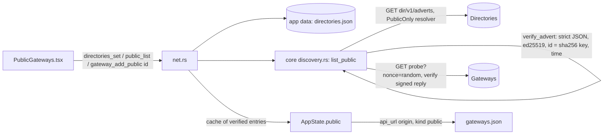

# Public gateway list (phase I2b)

* **Status:** built 2026-11-17 on PR #1's branch, after phase I2a. Phase I2 of the IDE plan in the P2P-AI repository
  (`docs/restructure/agentic-ide-plan.md` section 5, ADR-029 D4), using the gateway advertisements of ADR-021 and the
  `client_access` block of ADR-028. Requested by Pheonix ("keep moving forward", 2026-11-17).
* **Code:** `core/src/discovery.rs`, `app/src-tauri/src/net.rs` (four commands), `app/src/components/PublicGateways.tsx`,
  `app/src/ipc.ts`. Tests: `core/tests/discovery.rs`, `app/tests/ui-smoke.mjs`.
* **Next:** I3 gives the chat its tools (read, search, patch) with diff review.

## 1. Overview

Besides the gateway on this computer and gateways added by address, the Gateways view can now list **public
gateways**: gateways whose operators publish a signed advertisement saying they serve people (a `client_access`
block). The person adds one or more **directories** they trust, presses **Refresh list**, and sees each gateway's
region, measured latency, models, how to get a key (from the operator, or a sign-up page), and whether the operator
says prompts are logged and for how long. **Add** saves it like any other gateway; the key is added afterwards with
**Add key**.

The IDE ships with **no directory**: it fetches nothing until the person adds one.

## 2. How it works

1. `directories_set` checks and saves up to 8 directory URLs (`directories.json`, see [files/app-data.md](../files/app-data.md)).
2. `public_list` (in a background thread) fetches `GET <directory>/v1/adverts` from each one: `{ "adverts": [ "<signed
   advert text>", ... ] }`, at most 500 adverts and 2 MiB per answer.
3. Each advert is verified by `verify_advert`, a port of the P2P-AI node's verifier, in the protocol's fixed order:
   size, strict JSON, field allow-list, endpoints, times, enrollment, node and hub fields, summary, public key,
   `gateway_id == first 40 hex of SHA-256(key)`, the ed25519 signature over `P2PAD-V1\n` + canonical JSON without
   `sig`, then issued/expiry time. Adverts without `client_access` are node-facing only and are counted as
   `not_for_users`.
4. Per gateway, the advert with the highest `seq` across all directories wins.
5. Each gateway is probed once (16 in parallel): `GET <probe>?nonce=<32 hex from the OS CSPRNG>`. The latency counts
   only if the reply echoes the nonce, names the gateway, is within 120 s and is signed with the advert's key over
   `P2PPROBE-V1\n{nonce}\n{ts}\n{gateway_id}`. Gateways behind a relay name are listed without a latency.
6. The list (fastest first) and the rejection counts by reason code go to the webview, and the shell keeps the
   verified entries in memory.
7. `gateway_add_public(gateway_id, key)` looks the id up in that cache, takes the origin of its `client_access.api_url`
   and saves it as a gateway of kind `public`. The webview never supplies the address.

| Command | Arguments | Returns |
|---|---|---|
| `directories_list` | none | saved directory URLs |
| `directories_set` | `directories: string[]` | the saved (checked, de-duplicated) list |
| `public_list` | none | `{gateways: [{gateway_id, region, models, access: {mode, api_url, signup_url, features, terms_url, logs_prompts, retention_days}, latency_ms, directories}], rejected: {code: count}}` |
| `gateway_add_public` | `gatewayId`, `key` (optional) | new gateway id |

Rejection codes: `bad_directory`, `directory_unreachable`, `directory_too_large`, `too_large`, `bad_json`,
`bad_shape`, `bad_endpoint`, `bad_time`, `bad_enrollment`, `bad_key`, `bad_id`, `bad_signature`, `expired`,
`not_for_users`, `over_limit`.

## 3. How it is secure

Threat model (STRIDE, brief). Assets: the person's gateway keys (later), the choice of gateway, the person's network
position. Attackers: a hostile or compromised directory, a gateway lying in its advert, a network attacker, a DNS
name that points at a private address.

| Threat | Control | Reference |
|---|---|---|
| Forged or altered advert (spoofing, tampering) | ed25519 signature over canonical JSON, checked before time and before listing; `gateway_id` bound to the key; same code and vectors as the node | CWE-347, CWE-345, NIST SC-13 |
| Two parsers reading one advert differently | strict JSON: no duplicate keys, no floats or big integers, depth 6; exact field allow-list; closed value sets | CWE-694, CWE-20 |
| Directory or advert steering the IDE at private hosts (SSRF) | every URL `https://` to a public host; no user info, localhost, `.local`/`.internal`, private/link-local/metadata/CGNAT IPv4, IPv6 literals or numeric IPv4 tricks; relay names only where the protocol allows | CWE-918 |
| DNS rebinding | `PublicOnly` resolver drops private addresses after DNS, for the directory, probe and for every request to a gateway of kind `public` (so a key is never sent to a private address) | CWE-918, CWE-350 |
| Redirect or proxy taking traffic elsewhere | no redirects, no proxy from the environment, TLS verification on with the Mozilla roots | CWE-601, CWE-295, NIST SC-8 |
| Replayed or forged latency | fresh 128-bit nonce from the OS CSPRNG; reply must be signed by the advert's key and fresh | CWE-294, CWE-330 |
| Webview choosing the saved address | adding sends only the advert id; the shell takes the address from its verified cache | CWE-345, CWE-639 |
| Hostile advert text (XSS, misleading links) | all advert strings rendered as React text; links are not clickable, they can be copied; the region in a saved name is filtered to letters, digits and `-` | CWE-79, CWE-601, CWE-117 |
| Resource exhaustion | 8 directories, 2 MiB / 500 adverts per answer, 4 KiB per advert, 100 listed gateways, 2 KiB probe replies, 10 s per request, 16 probes at a time | CWE-400, CWE-770 |
| Leaking details in errors and logs | rejections counted by fixed code; audit lines "public_list fetched", "directories set", "gateway added_public", "refused directory_input" | CWE-209, CWE-117, NIST AU-3 |
| Listing treated as trust | the list gives no trust: nothing is sent to a listed gateway except the probe until the person adds it and gives it a key; what an advert says about logging is the operator's claim and is shown as such | NIST SA-9 |

## 4. How to use it

1. Open **Gateways** (network icon). Under **Public gateways**, type a directory address such as
   `https://directory.example.org` and press **+**.
2. Press **Refresh list**. Each entry shows its short id, region, latency (`41 ms`, or `no probe`), models, how to
   get a key, and the prompt-logging statement. **API**, **Sign-up** and **Terms** addresses have a copy button.
3. Press **Add** on the one you want. It appears in the saved list as `Public fe812c12 (eu)`, marked *public list*.
4. Get a key (sign-up page, or from the operator), press **Add key** on the saved gateway, then **Check**.
5. Remove a directory with the **x** next to it.

## 5. Dependencies

| Name | Version | Purpose | CVE check |
|---|---|---|---|
| ed25519-dalek | 2.2.0 (default features; curve25519-dalek 4.1.3) | verify advert and probe signatures (same as the P2P-AI node) | cargo audit 2026-11-17: no advisories |
| base64 | 0.22.1 | decode keys and signatures (canonical form only) | cargo audit 2026-11-17: no advisories |
| getrandom | 0.2.17 | OS CSPRNG for probe nonces (already in the tree through ring) | cargo audit 2026-11-17: no advisories |
| ureq | 3.5.2 (unchanged) | HTTPS with a custom resolver (`Agent::with_parts`) | as in I2a |

## 6. Limitations and known risks

* A directory chooses which adverts to show and can hide gateways; it cannot forge one. Use more than one directory.
* What an advert says (region, models, logging, retention) is the operator's claim, signed by the operator. The IDE
  verifies who said it, not that it is true.
* An `api_url` with a path (for example `https://host/api/`) cannot be added yet: the client puts `/v1/...` on the
  origin.
* Gateways reachable only through a relay (ADR-026) are listed without latency, and adding them fails because their
  API address is never a relay name.
* IPv6-only gateways and directories are refused (as in the node).
* No proxy support (same as I2a).
* Latency is one probe from this computer at refresh time.

## 7. Troubleshooting

| Message | Cause and fix |
|---|---|
| "a directory must be a public https://host[:port] address with no user name" | http, a private or local address, a query, or user info in the address |
| "add a directory first" | the directory list is empty |
| "N entries skipped (directory unreachable 1)" | the directory is down, not a P2P-AI directory, or its name resolves to a private address |
| "... (bad signature N)" or "(expired N)" | the directory serves altered or old adverts; the entries are not shown |
| "... (not for users N)" | those gateways serve nodes only (no `client_access`) |
| "that gateway is not in the last list; refresh it" | the list was refreshed or the app restarted; press **Refresh list** |
| "this gateway's API address has a path, which the IDE cannot use yet" | see Limitations |

## 8. Test evidence

* [Core: fmt, clippy, 41 tests incl. the shared protocol vectors and a fake directory](../../HistoryTest/runs/2026-11-17_063819Z_core_545bdf4/RUN.md)
* [Tauri shell: fmt and clippy with the public list commands](../../HistoryTest/runs/2026-11-17_063821Z_shell_545bdf4/RUN.md)
* [Webview: type check, unit tests, build, UI smoke 37/37 with the public list](../../HistoryTest/runs/2026-11-17_063823Z_ui-smoke_545bdf4/RUN.md)
* [cargo audit of both lockfiles: 0 vulnerabilities](../../HistoryTest/runs/2026-11-17_063832Z_security-scan_545bdf4/RUN.md)
* Windows build and click-through: still to do (with the I2a click-through).
