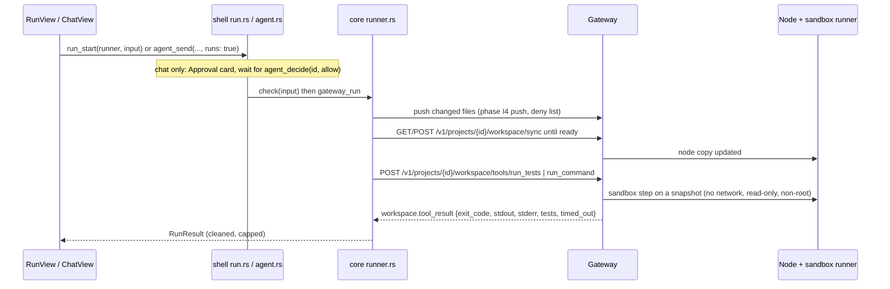

# Run and test, and runs the assistant asks for (phase I5b)

* **Status:** built 2026-11-17 after phase I5a was merged (PR #7). Part of phase I5 of the IDE plan in the P2P-AI
  repository (`docs/restructure/agentic-ide-plan.md`: "Commands and tests through the OS sandbox"). Order chosen by
  Pheonix on 2026-11-17: "Do recommended first but include local os sandbox ported from tandemforge and include
  support for local container like docker or podman". So this page covers the gateway sandbox; a local OS sandbox
  (I5c, ported from TandemForge's host runner) and a local Docker or Podman container (I5d) come next and will plug
  into the same request and result.
* **Code:** `core/src/runner.rs`, `core/src/agent.rs` (run tools), `core/src/gwapi.rs` (`api_slow`),
  `app/src-tauri/src/{run,agent,missions,main}.rs`, `app/src/components/{RunView,ChatView}.tsx`, `app/src/{App.tsx,ipc.ts}`.
* **Tests:** `core/src/runner.rs`, `core/src/agent.rs` (`run_tools_go_through_the_runner_only`),
  `app/tests/ui-smoke.mjs` (Run and test flow, approval card), `core/examples/live_runs.rs` with
  `scripts/live_gateway_e2e.py --example live_runs` (real gateway, node and sandbox).

## 1. Overview

The **Run and test** view (flask icon in the activity bar) runs the open folder's tests or one program in a sandbox
and shows the result:

* **Tests:** pick a framework (`cargo`, `go`, `make`, `npm`, `pytest`, `unittest`). The result shows passed, failed
  and skipped counts, the names of failing tests, and the output.
* **Command:** type a program and its arguments, such as `python3 -m pytest -q`. There is no shell: words are split
  on spaces, `"quotes"` keep spaces in one word, and `;`, `|`, `$HOME` or `*` reach the program as plain text.
* **Where to run:** the **Gateway sandbox** runs on a node of the folder's linked project (link it in Missions). It
  has no network, its file changes are not kept, and secrets such as `.env` and keys are never sent. The local
  sandbox and the local container are listed and marked as coming next.

In **Agent chat**, the **Runs** switch (off by default, next to **Tools**) lets the assistant ask to run tests or a
command. Each request shows a yellow card with exactly what would run. Nothing runs until the person presses
**Allow run**; **Decline**, **Stop**, or no answer within 5 minutes means it does not run. The chat shows the
request, then the result (`ran run_tests pytest: exit code 0, tests 4 passed, 0 failed`), and the assistant gets the
exit code, test counts and the end of the output.

## 2. How it works

* **Request** (`RunInput`): `kind` `tests` or `command`; `framework` (tests); `argv` (command, 1-64 words of at most
  4096 bytes, no control characters other than newline and tab); `cwd` relative to the root (passes the workspace
  allow-list and the agent deny list); `timeout_s` 10-300, default 120.
* **Gateway call:** the P2P-AI gateway's sandbox tools (`GATEWAY_EXEC` on the gateway, editor role on the project).
  The person's click is the intent, so the IDE calls the tool route directly; the chat's runs add the IDE's own
  approval card in front.
* **Result** (`RunResult`): `runner`, `place` (the node), `summary`, `exit_code`, `timed_out`, `duration_ms`,
  `stdout`, `stderr` (64 KiB each kept), `truncated`, `tests {passed, failed, skipped, total, failures[]}`, `error`.
  The model gets at most 16 KiB (counts, failing names, the end of each stream).
* Stages are reported while a run goes on: `sending`, `copying`, `running`.

| Command | Arguments | Returns |
|---|---|---|
| `run_start` | `runner` (`gateway`), `input` (`RunInput`), `onStage` channel | `RunResult` |
| `agent_send` | adds `runs` (bool, default false) | as before; events add `approval {id, summary, runner}` and `run {id, result}` |
| `agent_decide` | `id`, `allow` | nothing; refused when that id is not waiting |

Agent tools (offered only with Runs on and a linked folder):

| Tool | Arguments | Notes |
|---|---|---|
| `run_tests` | `framework` (enum), `cwd?` | needs Allow |
| `run_command` | `argv` (list of strings), `cwd?` | needs Allow; no shell |

## 3. How it is secure

Threat model (STRIDE, brief). Assets: the person's computer, code and secrets; the gateway node. Attackers: a
prompt-injected model (instructions hidden in a file or in program output), hostile output from the program under
test, a gateway or node that answers with hostile data.

| Threat | Control | Reference |
|---|---|---|
| The model runs something the person did not want (prompt injection, excessive agency) | run tools only with Runs on (off by default); a checked request is shown exactly on a card; nothing runs before Allow; Decline, Stop, a closed window or 5 minutes without an answer decline; one waiting request at a time, answered only by its own random id | OWASP LLM01, LLM06; NIST AC-3, AC-6; CWE-639 |
| Shell injection through words | no shell anywhere: an argument list or a framework name from a fixed list; the gateway runner also uses argv | CWE-78, CWE-88 |
| Path tricks in the folder to run in | `cwd` passes the workspace allow-list (no `..`, absolute paths, `.git`) and the agent deny list | CWE-22, CWE-73 |
| Secrets leave the computer | the push is phase I4's: deny list (`.env`, keys, `.ssh`, `secrets/` ...), symlinks skipped; the live check searches every stored file for the `.env` value | CWE-200, CWE-538 |
| The program reaches the network or keeps changes | the gateway's sandbox runner: no network, all capabilities dropped, read-only root, non-root, limits, on a snapshot (verified live: a connect attempt fails) | NIST SC-7, SC-39; CIS Docker 5.x |
| Runaway runs | 10-300 s per run (the sandbox stops it, verified live), one push or run at a time per window, output capped (64 KiB per stream, 16 KiB to the model) | CWE-400, CWE-770 |
| Hostile output in the UI or chat | rendered by React as text in `<pre>`, no links; control characters removed except newline and tab; the model is told program output is data | CWE-79, CWE-150; OWASP LLM01 |
| Wrong runner | only `gateway` is accepted until I5c and I5d are built; other names are refused | deny by default, NIST CM-7 |
| Audit and leaks | audit words only: run started, run allowed, run declined; errors are fixed messages | NIST AU-3, CWE-117, CWE-532, CWE-209 |

## 4. How to use it

1. Open the folder and link it to a project on the active gateway (Missions view, **Create project and link**).
   The gateway needs its sandbox tools on (`GATEWAY_EXEC`) and a node with the sandbox runner.
2. Press the flask icon (**Run and test**).
3. Keep **Gateway sandbox**, pick **Tests** and a framework (or **Command** and type, for example,
   `python3 -c "print(1)"`), and press **Run pytest tests** (or **Run command**).
4. Read the verdict, counts, failing tests and output.
5. In **Agent chat**, turn **Runs** on and ask, for example, "fix the failing test and run the tests". Press
   **Allow run** on the card when the request is what you expect.

## 5. Dependencies

No new dependencies. Uses the P2P-AI gateway's workspace sync and sandbox tools (tested with P2P-AI at 28f06ad0),
React and lucide-react (already pinned). cargo audit and npm audit on 2026-11-17 (run linked below).

## 6. Limitations and known risks

* Runs use the files on disk, not the assistant's pending changes: accept a change before asking for a run that
  should see it.
* The gateway runs on a node of the linked project; the folder's files (minus the deny list) go to that gateway, as
  with Missions. For runs that must stay on this computer, wait for I5c (local OS sandbox) and I5d (container).
* The sandbox image decides which tools exist (python3, node, go, cargo ...). A missing program ends with
  `start_error`.
* A person-started run is not asked again: the click is the approval.
* While a run goes on, a send or pull in Missions waits (one at a time).

## 7. Troubleshooting

| Message | Cause and fix |
|---|---|
| "link this folder to a gateway project first" | link it in Missions (**Create project and link**) |
| "... or turn Runs off" | the chat's Runs switch needs a linked folder; link it or turn Runs off |
| "the node's copy of the project is not ready yet; try again shortly" | no node has finished copying the project within 2 minutes; check the gateway has a node online |
| "a send, pull or run is still going on" | wait for the other step to end |
| "pick a test framework: ..." / "a command is a program and its arguments ..." | the request did not pass the checks |
| "this runner is not available yet" | only the gateway sandbox exists in this version |
| A forbidden or not-found answer from the gateway | the key needs the editor role on the project, and the gateway `GATEWAY_EXEC` |

## 8. Test evidence

* [Core: fmt, clippy, 61 unit + 5 + 2 tests incl. request checks, output cleaning and run tools only through the runner](../../HistoryTest/runs/2026-11-17_125930Z_core_618354d/RUN.md)
* [Tauri shell: fmt and clippy with `run_start` and `agent_decide`](../../HistoryTest/runs/2026-11-17_125932Z_shell_618354d/RUN.md)
* [Webview: UI smoke 75/75 with the Run and test flow and the approval card (Allow and Decline)](../../HistoryTest/runs/2026-11-17_125934Z_ui-smoke_618354d/RUN.md)
* [Live: real P2P-AI gateway, node and sandbox, 13/13 (failing test named, local fix seen, no network, time limit, `.env` never stored)](../../HistoryTest/runs/2026-11-17_125953Z_live-gateway_618354d/RUN.md)
* [cargo audit and npm audit: 0 vulnerabilities](../../HistoryTest/runs/2026-11-17_125944Z_security-scan_618354d/RUN.md)
* [Live again after merging main (cap-std workspace, #8): 13/13](../../HistoryTest/runs/2026-11-17_131135Z_live-gateway_a6170be/RUN.md)
* [Windows PC build at 391278c: core 59 + 5 + 2, webview, audit, shell, release binary, all pass](../../HistoryTest/runs/2026-11-17_130113Z_windows_391278c/RUN.md)
