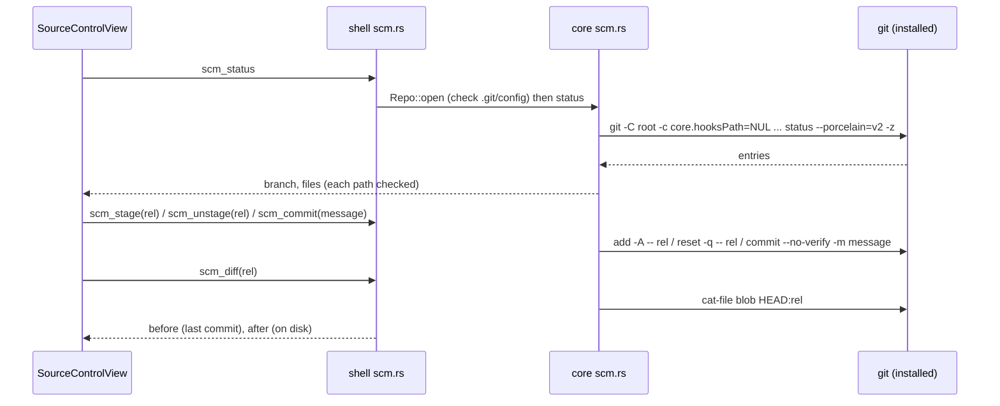

# Source Control view (phase I5a)

* **Status:** built 2026-11-17 after phase I4 was merged (PR #4, #5). Part of phase I5 of the IDE plan in the
  P2P-AI repository (`docs/restructure/agentic-ide-plan.md`: "Commands and tests through the OS sandbox; source control
  view"). Requested by Pheonix ("keep moving forward with the rest"). Commands and tests (I5b) follow separately.
* **Code:** `core/src/scm.rs`, `core/src/workspace.rs` (`check_rel`), `app/src-tauri/src/scm.rs`,
  `app/src/components/{SourceControlView,DiffReview}.tsx`, `app/src/{App.tsx,ipc.ts}`.
* **Tests:** unit and real-git tests in `core/src/scm.rs`; `app/tests/ui-smoke.mjs` (Source Control flow).

## 1. Overview

The **Source control** view (branch icon in the activity bar) shows the open folder's git repository: the branch,
how far it is ahead of or behind its upstream, the changed files split into **Staged** and **Changes**, and the last
50 commits. The person can:

1. click a file to see what changed since the last commit, in a view-only side-by-side diff;
2. stage or unstage one file (+ and −), or **Stage all** / **Unstage all**;
3. write a message and press **Commit**.

Commits stay on this computer: there is no fetch, pull or push, so no git credentials are ever used. Hooks in the
repository are not run.

## 2. How it works

* **git** is the person's own installation, found on PATH. The IDE adds no git library.
* **Repository check.** Every command first reads `.git/config` and refuses the repository if it sets something that
  makes git run a program or read other files during these commands (see section 3). The folder must be the top of
  the repository and hold a real `.git` folder (worktrees and submodules, where `.git` is a file, are not supported
  yet).
* **Status** uses `git status --porcelain=v2 -z --branch --no-renames --untracked-files=all` (machine format, no
  quoting). Each reported path is checked with the workspace's own path rules; a name the IDE would refuse
  elsewhere, anything in `.git`, and submodules are listed but get no actions.
* **Diff** compares `git cat-file blob HEAD:<path>` (no filters or text conversion) with the file on disk, both at
  most 5 MiB of UTF-8 text, in the same Monaco diff used for proposed changes, but without Accept or Reject.
* **Stage / unstage / commit:** `git add -A -- <path>`, `git reset -q -- <path>`, `git commit --no-verify -q -m <message>`.

| Command | Arguments | Returns |
|---|---|---|
| `scm_status` | none | `{available, reason, status: {branch, initial, ahead, behind, files[], truncated}}` |
| `scm_diff` | `rel` | `{rel, before, after, deleted}` |
| `scm_stage` / `scm_unstage` | `rel` (or null for all) | nothing |
| `scm_commit` | `message` | the new commit's short id |
| `scm_log` | none | `[{id, subject, author, time}]` (50 at most) |

## 3. How it is secure

Threat model (STRIDE, brief). Assets: the person's computer and code. Attackers: a repository someone else made
(downloaded or cloned), whose `.git/config`, hooks, attributes and file names are under the attacker's control;
hostile text in commit messages and names.

| Threat | Control | Reference |
|---|---|---|
| Opening a repository runs its code through git (hooks, filter programs, fsmonitor, signing program, included config) | hooks off on every call (`core.hooksPath` to the null device and `--no-verify`), `core.fsmonitor=false`; repositories whose own config sets `filter.*` (except the standard git-lfs lines), `gpg.*`, `include.*`, `includeIf.*`, `core.worktree`, `extensions.worktreeConfig` or `core.gitProxy` are refused before any git call; no external diff or text conversion is used; `protocol.allow=never` | CWE-829, CWE-94, CWE-78 |
| A planted `git` program in the folder | git is taken only from absolute PATH entries outside the open folder | CWE-427 |
| Argument or pattern injection through file names | argument lists only, no shell; paths come after `--`; `GIT_LITERAL_PATHSPECS=1` so `*` or `:(top)` is a plain name; every path passes the workspace allow-list; `.git` is never acted on | CWE-88, CWE-22, CWE-73 |
| Environment influence (`GIT_DIR`, `GIT_CONFIG_*`, proxies, editors) | git gets a cleared environment: PATH, home, temp and Windows system folders only, plus `GIT_TERMINAL_PROMPT=0`, `GIT_OPTIONAL_LOCKS=0`, `LC_ALL=C` | CWE-526, CWE-15 |
| Network or credential use | no fetch, pull or push; `protocol.allow=never`; no prompts | NIST AC-6, SC-7 |
| Resource exhaustion | 60 s per git call (then killed), 8 MiB output, 5000 files, 50 commits, 5 MiB per diff side, one write at a time | CWE-400, CWE-770 |
| Hostile names and messages in the UI | React text only, no links; Monaco read-only diff with links off; control characters removed | CWE-79, CWE-150 |
| Error and log leaks | fixed messages chosen from a short list; git's own text never shown; audit words only (scm staged, unstaged, committed) | CWE-209, CWE-532, NIST AU-3 |

The person's own global git settings (for example git-lfs, `commit.gpgSign`) still apply: they are the person's
choice, not the repository's.

## 4. How to use it

1. Open a folder that is a git repository (its top folder).
2. Press the branch icon (**Source control**).
3. Click a file under **Changes** to see the diff; press **+** to stage it (or **Stage all**).
4. Write a message and press **Commit 1 staged**. The new commit shows under **History**.
5. Press the refresh icon after changing files elsewhere.

## 5. Dependencies

No new dependencies. Uses the installed git (tested with git 2.43 on Linux; Git for Windows on the PC), React and
lucide-react (already pinned). cargo audit and npm audit on 2026-11-17 (run linked below).

## 6. Limitations and known risks

* No fetch, pull, push, branch switching, discard or merge-conflict tools yet; use a terminal or another git client.
* Worktrees and submodules (where `.git` is a file) are not supported; submodule entries are listed without actions.
* Some repositories are refused on purpose (a local filter other than git-lfs, signing settings, includes). The
  message says so; the person can still use git outside the IDE.
* Git itself is trusted: a compromised git installation is out of scope.
* The person's global settings may name programs (git-lfs, a signing program); those run as they would in a terminal.
* Commits use the person's name and email from git's settings; without them the commit is refused with a hint.

## 7. Troubleshooting

| Message | Cause and fix |
|---|---|
| "git was not found; install Git to use source control" | install Git and restart the IDE |
| "this folder is not the top of a git repository" | open the repository's top folder, or run `git init` there |
| "this repository's own git settings name programs to run ..." | the repository's `.git/config` has a filter, signing or include setting; check it, or use git outside the IDE |
| "git does not trust this folder because another user owns it" | git's `safe.directory` protection; fix the folder's owner, or add it with `git config --global --add safe.directory <path>` if you trust it |
| "set your name and email in git first ..." | `git config --global user.name "Your Name"` and `user.email` |
| "stage at least one change before committing" | press + on a file first |

## 8. Test evidence

* See the HistoryTest runs linked from the CHANGELOG entry for this phase (core, shell, UI smoke, security scan).
