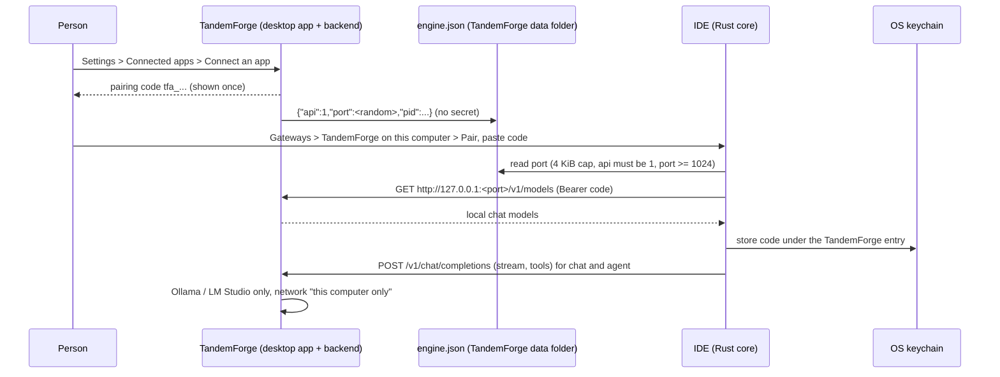

# TandemForge on this computer as a model engine (phase I7)

Status: built 2026-11-21. Needs TandemForge with "Connected apps" (TandemForge branch `claude/project-thread-8u4b8a`,
its page `docs/connected-apps.md`).

## 1. Overview

TandemForge is the desktop app that runs local models (Ollama or LM Studio) for its own missions. With phase I7 the IDE
can use those same local models: chat and the agent talk to TandemForge exactly as they talk to a P2P-AI gateway, but
nothing leaves the computer.

The owner decided on 2026-11-21 that the IDE **connects to a running TandemForge** (it does not bundle or start one).
TandemForge stays in charge: it decides which apps may use its models, and it can disconnect them at any time.

## 2. How it works

- **Finding TandemForge.** TandemForge picks a free port at each launch. While at least one app is connected it writes
  `engine.json` beside its database, in its data folder `com.tandemforge.desktop`:
  `%APPDATA%\com.tandemforge.desktop` on Windows, `~/Library/Application Support/com.tandemforge.desktop` on macOS,
  `$XDG_DATA_HOME/com.tandemforge.desktop` then `~/.local/share/com.tandemforge.desktop` on Linux. The core module
  `core/src/tandemforge.rs` reads only the port from it and builds `http://127.0.0.1:<port>`.
- **The saved entry.** Pairing saves one gateway entry of kind `tandemforge`, named "TandemForge (this computer)",
  and makes it active. There is at most one; pairing again replaces its code. Before each use the shell re-reads
  `engine.json` and updates the entry's port (`set_tandemforge_url`), so a restart of TandemForge needs nothing.
- **Talking to it.** The same `client.rs` code as for gateways: `/v1/models`, `/v1/chat/completions` with
  `stream: true` and tool definitions. TandemForge sends SSE comments as keep-alives while a model loads; the client
  skips them. TandemForge answers in one piece (content, then tool calls, then the finish reason).
- **Shell commands.** `tandemforge_status` (running?, reason, paired entry id) and `tandemforge_connect(code)`
  (check the code's shape, find the port, try `/v1/models` with the code, then save).
- **UI.** `app/src/components/TandemForgeConnect.tsx` in the Gateways view: status line, Pair button, password field
  for the code, Refresh. The saved entry shows "paired (code in keychain)" and has no key or CA buttons.

## 3. How it is secure

| Threat | Control | Reference |
|---|---|---|
| The code is sent somewhere else | The URL is only ever `http://127.0.0.1:<port>`; `load` refuses a TandemForge entry with any other URL; no proxy, no redirects | NIST SC-7, CWE-918 |
| A damaged or hostile `engine.json` | Read capped at 4 KiB, strict JSON, `api` must be 1, only the port is taken and it must be 1024 to 65535 | CWE-20, CWE-400 |
| Another local program steals the code | The code is kept only in the OS keychain, never in the gateways file, logs or the webview; the input is a password field cleared at once | CWE-522, CWE-532 |
| Wrong code | TandemForge answers 401; the IDE says so and saves nothing | NIST IA-2 |
| A paired app goes too far in TandemForge | TandemForge accepts the code only on `/v1` (and health); every `/api` route stays closed to it; requests are pinned to local models; at most 2 replies at once | NIST AC-3, AC-4, AC-6 |
| Plain http | Loopback only, on the same computer; https stays required for every non-loopback address. The entry is not shown as "INSECURE — DEV ONLY" because no network is crossed | NIST SC-8 |
| Errors leak details | Fixed messages, no paths | CWE-209 |

Writing code this way does not by itself make the IDE compliant with these standards; formal compliance needs an assessment.

## 4. How to use it

1. In TandemForge: **Settings > Connected apps**, type a name (default "P2P-AI IDE"), **Connect**. Copy the code; it
   is shown once.
2. In the IDE: open **Gateways**. The panel **TandemForge on this computer** should say "Running. Pair the IDE…".
3. **Pair with TandemForge**, paste the code, **Pair**. The IDE checks the code and lists "TandemForge (this computer)"
   as the active entry.
4. Open the chat and pick one of TandemForge's models.

To stop: **Disconnect** the app in TandemForge (the code stops working at once), and **Remove** the entry in the IDE.

## 5. Dependencies

No new crate or npm package. Uses `serde_json` and `ureq` (already pinned in `core/Cargo.lock`). `cargo audit` and the
npm audit gate on 2026-11-21: no vulnerabilities (warnings carried over, see SECURITY-LOG).

## 6. Limitations and known risks

- TandemForge must be running with at least one connected app; otherwise there is no `engine.json`.
- Any program running as the same user can read `engine.json` (no secret in it) and could try codes; codes are 256-bit
  random values, so guessing is not practical.
- Replies arrive in one piece, not word by word (TandemForge asks its model for a whole reply).
- Only TandemForge's local models (Ollama, LM Studio); TandemForge never forwards these requests to a P2P-AI gateway.

## 7. Troubleshooting

| Message | Fix |
|---|---|
| "TandemForge is not running on this computer, or no app is connected in it" | Start TandemForge; connect an app in Settings > Connected apps |
| "TandemForge's engine file could not be read" | Update or restart TandemForge |
| "paste the pairing code… it starts with tfa_" | Copy the whole code from TandemForge |
| "TandemForge did not accept this code" | The app was disconnected or the code mistyped; connect again in TandemForge |
| No models listed | Start Ollama and pull a chat model |

## 8. Test evidence

- [Core unit tests](../../HistoryTest/runs/2026-11-21_205545Z_core_1e284ce/RUN.md): 83 passed, 1 ignored.
- [UI smoke test](../../HistoryTest/runs/2026-11-21_205557Z_ui_1e284ce/RUN.md): 91 of 91, 4 new TandemForge checks.
- [End to end against a real TandemForge backend](../../HistoryTest/runs/2026-11-21_205630Z_tf-engine-e2e_1e284ce/RUN.md)
  (fake Ollama, no real model): wrong code refused, models, chat, slow reply with keep-alives, a tool call and the step
  after it, gateway model refused, revoke closes access and removes `engine.json`.
- [App unit tests](../../HistoryTest/runs/2026-11-21_205604Z_app-unit_1e284ce/RUN.md) and
  [static checks and scans](../../HistoryTest/runs/2026-11-21_205639Z_security-scan_1e284ce/RUN.md).
- Not run yet: the real desktop apps side by side on the PC with a real model.
