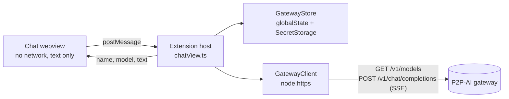

# P2P-AI extension for VS Code and VSCodium (side track X)

Status: **X1 built** (2026-11-22): chat view and gateway picker. X2 (local agent tools with diff review) and X3
(missions) come next. Not published yet: releases are paused, so it is installed from the `.vsix` file.

## 1. Overview

ADR-029 (P2P-AI repository, `docs/DECISIONS.md`) adds a side track to the IDE: an extension that brings the
P2P-AI gateway chat to people who already use VS Code or VSCodium. It lives in this repository under
`vscode-extension/`.

X1 adds:

* a **P2P-AI** view in the activity bar with a chat that streams the answer and can be stopped;
* commands **P2P-AI: Add Gateway, Pick Gateway, Pick Model, Set Gateway Key, Remove Gateway, New Chat**;
* gateways saved by name and address, keys in VS Code's secret storage, an optional pinned CA per gateway.

## 2. How it works



* `src/gateway/checks.ts` is a TypeScript port of the IDE's Rust checks (`core/src/client.rs`,
  `core/src/gateways.rs`): URL, name, key and model checks, the SSE line parser, the model list parser and the
  HTTP status mapping. It has no `vscode` import, so it is tested with plain Node.
* `src/gateway/client.ts` makes the two requests with Node's own `https` (no added dependency).
* `src/gateways.ts` keeps the list in VS Code's global state and each key in `SecretStorage`.
* `src/chatView.ts` is the side-bar webview; `media/chat.js` draws it.

**One client contract, two languages.** The ADR planned one TypeScript client shared with the IDE. The IDE's client
is in Rust on purpose (the webview never holds a key), so instead both clients run the same test cases from
`core/tests/vectors/gateway_client.json` (Rust: `core/src/gateway_vectors.rs`; TypeScript:
`vscode-extension/tests/vectors.test.ts`). A change to one that the other doesn't match fails a test. Writing
those cases found one real difference: the Rust URL check dropped text after an IPv6 `]` instead of refusing it.
It is fixed.

## 3. How it is secure

| Threat | Control | Reference |
|---|---|---|
| Key stolen from disk or settings | Keys only in `SecretStorage` (OS keychain where VS Code has one); never in settings, global state, the webview or logs; typed into password boxes | CWE-312, CWE-522, CWE-549, ASVS V6.4 |
| Key sent to the wrong host | Strict URL allow-list (scheme, host, port only); redirects never followed (3xx is an error); the key only in `Authorization` | CWE-601, CWE-918, CWE-522 |
| Key over plain http | `https` only, except loopback marked **INSECURE — DEV ONLY** in the view and the picker | CWE-319, NIST SC-8 |
| Forged gateway certificate | Normal trust roots, or a pinned CA (PEM, at most 64 KiB, checked) passed as the only `ca` | CWE-295 |
| Script injection through answers | Webview CSP `default-src 'none'`, nonce scripts from the extension's own folder, no command URIs; every message drawn with `textContent` | CWE-79, NIST SC-18 |
| Hostile webview messages | Allow-listed message types, text capped at 256 KiB (`viewMessages.ts`) | CWE-20, CWE-400 |
| Huge or endless answers | Caps: model list 1 MiB / 1000 ids, stream 8 MiB, one line 1 MiB, request 2 MiB / 200 messages; 15 s / 10 min timeouts; Stop aborts | CWE-400, CWE-770 |
| Leaks in error text | Fixed messages by error kind, at most an HTTP status; never the key, address or answer | CWE-209 |
| Other extensions reading keys | Nothing is exported (`exports` is undefined). Test hooks exist only when VS Code runs the extension in test mode with `P2P_AI_EXT_TEST=1` | CWE-668 |
| Bad stored values | Every saved gateway is re-checked on load; bad entries are dropped | CWE-20 |

**Accepted risk (SECURITY-WARNING):** VS Code can route extension requests through its configured proxy
(`http.proxySupport`) and add OS certificates to the trust list. TLS stays end to end through a proxy, but with a
pinned CA the OS roots may then also be trusted. TODO(security): check the peer chain against the pinned CA in
`checkServerIdentity`.

## 4. How to use it

```sh
cd vscode-extension
npm ci
npm run package                    # builds out/ and p2p-ai.vsix
code --install-extension p2p-ai.vsix   # or: codium --install-extension p2p-ai.vsix
```

Then run **P2P-AI: Add Gateway**, open the **P2P-AI** view, click **Pick a model** and type (Ctrl+Enter sends).
**New** starts a new chat; **Stop** ends an answer early. The scripts are listed in
[commands/vscode-extension.md](../commands/vscode-extension.md).

## 5. Dependencies

Run-time: none besides VS Code's own API and Node's built-in modules.

| Dev dependency | Version (exact) | Purpose | CVE check |
|---|---|---|---|
| `typescript` | 7.0.2 | Compile `src/` to `out/` | npm audit 2026-11-22: 0 |
| `@types/vscode` | 1.95.0 | API types for the oldest supported VS Code (`engines.vscode` ^1.95.0) | npm audit 2026-11-22: 0 |
| `@types/node` | 22.20.5 | Node types, same as the app | npm audit 2026-11-22: 0 |
| `@vscode/test-electron` | 3.1.0 | Downloads VS Code and runs the integration test | npm audit 2026-11-22: 0 |
| `@vscode/vsce` | 4.1.1 | Builds the `.vsix` | npm audit 2026-11-22: 0 with `minimatch` overridden to 11.0.9 (GHSA-g3hv-75wg-m249 affects 7.0.0-11.0.0) |

## 6. Limitations and known risks

* Not published on Open VSX or the Marketplace yet (releases are paused).
* X1 has plain chat only: no tools on the open folder (X2) and no missions (X3).
* Chats are kept in memory; closing VS Code ends them.
* Only manual gateways (name, address, key); the IDE's signed public gateway list isn't in the extension yet.
* Tested on VS Code 1.95.0 and 1.147.0 (Linux). VSCodium uses the same extension API, but no VSCodium run has been
  recorded yet.
* The proxy and OS-certificate note in section 3.

## 7. Troubleshooting

| Message | Fix |
|---|---|
| `this gateway has no key yet` | Run **P2P-AI: Set Gateway Key**. |
| `the gateway refused the key` | The key is wrong or revoked; set a new one. |
| `the gateway's certificate is not trusted` | Add the gateway again with its CA file, or check its certificate. |
| `the address must be https://host[:port]` | Use the gateway's base address only, without a path. Plain http works only for `127.0.0.1`, `localhost` or `[::1]`. |
| The view is empty | Run **P2P-AI: Add Gateway** first, then **Pick a model**. |

## 8. Test evidence

* [Core with the shared cases, 99 + 5 passed](../../HistoryTest/runs/2026-11-22_112152Z_core_a704618/RUN.md)
* [Extension unit tests, 14 of 14](../../HistoryTest/runs/2026-11-22_112214Z_vscode-ext-unit_a704618/RUN.md)
* [Real VS Code 1.147.0](../../HistoryTest/runs/2026-11-22_112214Z_vscode-ext-integration_a704618/RUN.md) and [1.95.0](../../HistoryTest/runs/2026-11-22_112220Z_vscode-ext-integration_a704618/RUN.md)
* [npm audit, 0 findings](../../HistoryTest/runs/2026-11-22_112222Z_vscode-ext-audit_a704618/RUN.md); [.vsix package](../../HistoryTest/runs/2026-11-22_112223Z_vscode-ext-package_a704618/RUN.md)
