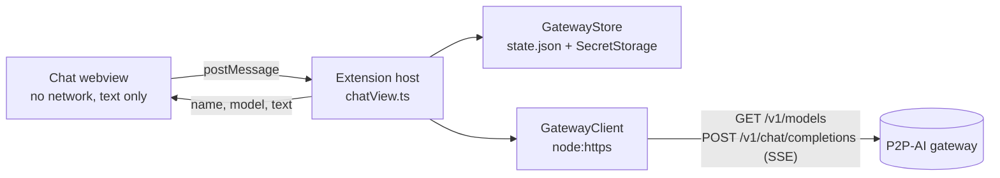
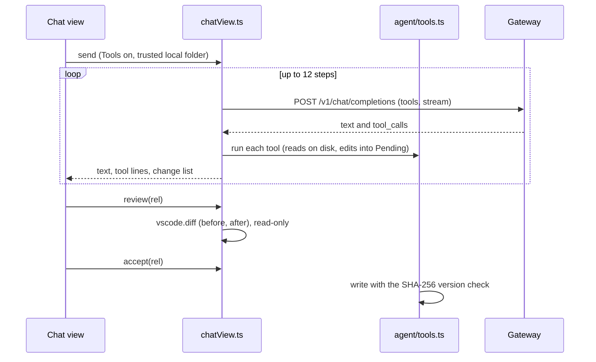

# P2P-AI extension for VS Code and VSCodium (side track X)

Status: **X1, X2 and X3 built** (2026-11-22): chat view and gateway picker (X1); agent tools on the open folder with
diff review (X2); missions (X3). Not published yet: releases are paused, so it is installed from the `.vsix` file.

## 1. Overview

ADR-029 (P2P-AI repository, `docs/DECISIONS.md`) adds a side track to the IDE: an extension that brings the
P2P-AI gateway chat to people who already use VS Code or VSCodium. It lives in this repository under
`vscode-extension/`.

X1 adds:

* a **P2P-AI** view in the activity bar with a chat that streams the answer and can be stopped;
* commands **P2P-AI: Add Gateway, Pick Gateway, Pick Model, Set Gateway Key, Remove Gateway, New Chat**;
* gateways saved by name and address, keys in VS Code's secret storage, an optional pinned CA per gateway.

X2 adds, like the IDE's phase I3 ([agent-tools.md](agent-tools.md)):

* a **Tools** switch in the chat (on by default). With a trusted local folder open, the model can list folders, read
  files and search (`list_dir`, `read_file`, `search`), and propose edits and new files (`edit_file`, `create_file`).
  Every tool step shows as a short line in the chat, such as `⚙ read_file src/orders.py`;
* **Changes to review**: each proposed file with its line counts and **Review**, **Accept** and **Reject**. Review
  opens VS Code's own diff editor, read-only, titled "(proposed change, not saved)". Its title bar also has
  **Accept Change** and **Reject Change** (commands **P2P-AI: Accept Change** and **P2P-AI: Reject Change**).
  Nothing is written until Accept.

X3 adds, like the IDE's phase I4 ([missions.md](missions.md)):

* a **Missions** view under the chat. **Pick a project** (or **Create project**) ties the open folder to a project on
  the active gateway. **Send folder to the project** uploads the folder (the deny list keeps secrets home),
  **Collect changes** brings the gateway's work back and **Review changes** puts each changed file in the chat's
  **Changes to review** list, where it is accepted or rejected per file as in X2;
* the **Autopilot** and **Auto Improve** switches of the project, **Start** for a mission (goal, model, framework
  and acceptance checks), and **Pause**, **Resume** and **Stop** for running missions;
* **Approvals**: a mission's request to run a command shows the tool and its arguments, with **Approve** and
  **Reject**. The decision carries the SHA-256 of the arguments the extension itself fetched and showed;
* Auto Improve **proposals** with **Accept**, **Dismiss** and **Snooze 7 days**;
* audit lines (fixed words, no paths or goals) in the **P2P-AI** output channel.

The extension's settings (gateways without keys, the active gateway, the picked models, the Tools switch and the
folder-to-project links) now live in `state.json` in its global storage folder instead of VS Code's `globalState`.
On VS Code 1.147 a `globalState` write was sometimes undone a moment later (about 1 run in 9 in the integration
test); a file of its own, read fresh and written atomically, has no such race. Old values move over once.

## 2. How it works



* `src/gateway/checks.ts` is a TypeScript port of the IDE's Rust checks (`core/src/client.rs`,
  `core/src/gateways.rs`): URL, name, key and model checks, the SSE line parser, the model list parser and the
  HTTP status mapping. It has no `vscode` import, so it is tested with plain Node.
* `src/gateway/client.ts` makes the two requests with Node's own `https` (no added dependency).
* `src/gateways.ts` keeps the list in `state.json` (X1 and X2 used VS Code's global state) and each key in `SecretStorage`.
* `src/chatView.ts` is the side-bar webview; `media/chat.js` draws it.
* X2: `src/agent/workspace.ts` is the open folder (list, read, search, atomic version-checked write);
  `src/agent/tools.ts` is a port of the IDE's `core/src/agent.rs` (tools, deny list, pending changes, the turn loop of
  up to 12 model steps); `src/review.ts` holds the pending changes per folder, serves both sides of the diff from
  memory (`p2p-ai-review:` documents) and writes on Accept; `GatewayClient.agentStep` sends the tools and collects the
  streamed `tool_calls`.
* X3: `src/missions/projects.ts` is a port of the IDE's `core/src/projects.rs` (push and pull plans, the gateway's
  path grammar, answer cleaning, view shapes, acceptance checks); `src/missionsView.ts` is the Missions webview and
  its handlers; `GatewayClient.api`, `uploadFile` and `download` make the project and mission calls;
  `src/fileState.ts` keeps the settings in `state.json`.



**One client contract, two languages.** The ADR planned one TypeScript client shared with the IDE. The IDE's client
is in Rust on purpose (the webview never holds a key), so instead both clients run the same test cases from
`core/tests/vectors/gateway_client.json` (Rust: `core/src/gateway_vectors.rs`; TypeScript:
`vscode-extension/tests/vectors.test.ts`). A change to one that the other doesn't match fails a test. Writing
those cases found one real difference: the Rust URL check dropped text after an IPv6 `]` instead of refusing it.
It is fixed.

X2 does the same for the agent: `core/tests/vectors/agent_tools.json` holds the tool definitions and system prompt
(byte for byte), the path rules, the deny list, path normalising, edit rules (including Windows line endings), line
ranges, line counts and argument errors. Rust runs it in `core/src/agent_vectors.rs`, TypeScript in
`vscode-extension/tests/agent.test.ts`. Both passed on the first run.

X3: `core/tests/vectors/missions.json` holds the gateway path grammar, ids, path encoding, upload names, error code
messages, push and pull plans, view shapes and acceptance checks. Rust runs it in `core/src/projects_vectors.rs`,
TypeScript in `vscode-extension/tests/missions.test.ts`.

```mermaid
sequenceDiagram
  participant V as Missions view
  participant E as missionsView.ts
  participant G as Gateway
  V->>E: push
  E->>G: upload each file (re-read, re-hashed), commit with base_version
  V->>E: start (goal, model, checks)
  E->>G: POST mission
  G-->>E: approval request (tool, arguments)
  E-->>V: approval with the arguments as text
  V->>E: decide(id, approve)
  E->>G: decision + SHA-256 of the arguments E fetched
  V->>E: pull
  E->>G: list files, download changed ones
  E->>E: SHA-256 must match the list; into Changes to review
```

## 3. How it is secure

| Threat | Control | Reference |
|---|---|---|
| Key stolen from disk or settings | Keys only in `SecretStorage` (OS keychain where VS Code has one); never in settings, global state, the webview or logs; typed into password boxes | CWE-312, CWE-522, CWE-549, ASVS V6.4 |
| Key sent to the wrong host | Strict URL allow-list (scheme, host, port only); redirects never followed (3xx is an error); the key only in `Authorization` | CWE-601, CWE-918, CWE-522 |
| Key over plain http | `https` only, except loopback marked **INSECURE — DEV ONLY** in the view and the picker | CWE-319, NIST SC-8 |
| Forged gateway certificate | Normal trust roots, or a pinned CA (PEM, at most 64 KiB, checked) passed as the only `ca` | CWE-295 |
| Script injection through answers | Webview CSP `default-src 'none'`, nonce scripts from the extension's own folder, no command URIs; every message drawn with `textContent` | CWE-79, NIST SC-18 |
| Hostile webview messages | Allow-listed message types, text capped at 256 KiB (`viewMessages.ts`) | CWE-20, CWE-400 |
| Huge or endless answers | Caps: model list 1 MiB / 1000 ids, stream 8 MiB, one line 1 MiB, request 2 MiB / 200 messages; 15 s / 10 min timeouts; Stop aborts | CWE-400, CWE-770 |
| Leaks in error text | Fixed messages by error kind, at most an HTTP status; never the key, address or answer | CWE-209 |
| Other extensions reading keys | Nothing is exported (`exports` is undefined). Test hooks exist only when VS Code runs the extension in test mode with `P2P_AI_EXT_TEST=1` | CWE-668 |
| Bad stored values | Every saved gateway is re-checked on load; bad entries are dropped | CWE-20 |
| Agent writes without consent (X2) | No tool writes, deletes, renames or runs anything; proposals stay in memory until the person presses Accept | OWASP LLM06, NIST AC-6 |
| Prompt injection from files (X2) | Tools only in a trusted workspace (Restricted Mode turns them off) on a local folder; system prompt marks tool output as data; every tool step is shown | OWASP LLM01 |
| Secrets sent to the gateway (X2) | Deny list (`.env`, keys, certificates, `.git/`, `.ssh/`, `secrets/` and others) for reads, edits, listings and search | CWE-200, CWE-538 |
| Path escape (X2) | Allow-list of plain `/` components; no `..`, absolute paths, backslashes, colons, control characters; links and junctions never followed (stricter than the IDE) | CWE-22, CWE-59, CWE-73 |
| Lost update on Accept (X2) | SHA-256 version check: a file changed on disk since the agent read it is refused; a new file never replaces one that appeared; atomic temp file and rename | CWE-367 |
| Hostile tool calls (X2) | Strict JSON arguments with only the tool's keys; unknown tools refused; 8 calls per step, 1 MiB arguments, 64 KiB per result, 1 MiB per turn, 12 steps, 5 MiB per file, 50 pending files | CWE-20, CWE-400, CWE-770 |
| Folder sent to the gateway without trust (X3) | Missions need a trusted local folder; push uses the agent deny list, never pulls those names back, and lists skipped names | CWE-200, CWE-538 |
| Odd names on the gateway (X3) | Only names the gateway's path grammar accepts (ASCII subset, no Windows device names, no case collisions); ids checked against a fixed pattern before they go into a URL | CWE-22, CWE-74, CWE-178, CWE-918 |
| Approving something other than what was shown (X3) | The decision carries the SHA-256 of the arguments the extension fetched and showed, never a value from the webview | CWE-345, OWASP LLM06 |
| Tampered or huge downloads (X3) | Each download must match the listed SHA-256 and be UTF-8 text; 50 files per pull, 5 MiB per file; pulled files only become pending changes | NIST SI-7, CWE-345, CWE-400 |
| Lost update on push (X3) | Each file is re-read and re-hashed just before upload; the commit carries `base_version`; one push, collect or pull at a time | CWE-362, CWE-367 |
| Hostile gateway text (X3) | Every field picked by name, typed, capped and stripped of control characters; drawn with `textContent` | CWE-20, CWE-79, CWE-150 |
| Settings undone or tampered (X3) | `state.json` written atomically (`wx` temp file, mode 0600, rename; folder 0700), read capped at 1 MiB, every value re-checked; keys never stored there | CWE-367, CWE-59, CWE-276, CWE-312 |
| Diff shown as markup (X2) | Both sides are plain-text read-only documents in VS Code's diff editor; the view sends only a path, looked up among pending changes | CWE-79, CWE-22 |

**Accepted risk (SECURITY-WARNING):** VS Code can route extension requests through its configured proxy
(`http.proxySupport`) and add OS certificates to the trust list. TLS stays end to end through a proxy, but with a
pinned CA the OS roots may then also be trusted. TODO(security): check the peer chain against the pinned CA in
`checkServerIdentity`.

**Accepted risk (SECURITY-WARNING, X2):** Node has no handle-based file access (`openat`, RESOLVE_BENEATH), so the
link check on each path component and the open are two steps. A program already running as the person could swap a
folder for a link between them and redirect one read or write. Such a program can already change the files itself.
TODO(security): use a handle-based walk if Node gains one.

## 4. How to use it

```sh
cd vscode-extension
npm ci
npm run package                    # builds out/ and p2p-ai.vsix
code --install-extension p2p-ai.vsix   # or: codium --install-extension p2p-ai.vsix
```

Then run **P2P-AI: Add Gateway**, open the **P2P-AI** view, click **Pick a model** and type (Ctrl+Enter sends).
**New** starts a new chat; **Stop** ends an answer early.

To let the assistant work on your code (X2): open a folder and trust it, keep **Tools** ticked and ask, for example,
"the total in orders.py is wrong, fix it". Its steps show in the chat. Then, under **Changes to review**, click
**Review** to see the diff, and **Accept** (or the ✓ in the diff's title bar) to save it, or **Reject**. Untick
**Tools** for a plain chat that sends no files. 

For missions (X3): in the **Missions** view click **Pick a project** (or type a name and **Create project**), then
**Send folder to the project**. Tick **Autopilot** (or **Auto Improve**), type a goal, pick a model and click
**Start**. When it asks to run a command, read the arguments and click **Approve** or **Reject**. When it is done,
click **Collect changes**, then **Review changes**, and accept or reject each file in the chat's list. The scripts are listed in
[commands/vscode-extension.md](../commands/vscode-extension.md).

## 5. Dependencies

Run-time: none besides VS Code's own API and Node's built-in modules.

| Dev dependency | Version (exact) | Purpose | CVE check |
|---|---|---|---|
| `typescript` | 7.0.2 | Compile `src/` to `out/` | npm audit 2026-11-22: 0 |
| `@types/vscode` | 1.95.0 | API types for the oldest supported VS Code (`engines.vscode` ^1.95.0) | npm audit 2026-11-22: 0 |
| `@types/node` | 22.20.5 | Node types, same as the app | npm audit 2026-11-22: 0 |
| `@vscode/test-electron` | 3.1.0 | Downloads VS Code and runs the integration test | npm audit 2026-11-22: 0 |
| `@vscode/vsce` | 4.1.1 | Builds the `.vsix` | npm audit 2026-11-22: 0 with `minimatch` overridden to 11.0.9 (GHSA-g3hv-75wg-m249 affects 7.0.0-11.0.0) |

## 6. Limitations and known risks

* Not published on Open VSX or the Marketplace yet (releases are paused).
* No run tools in the chat: the extension's agent can't run tests or commands itself (the IDE's I5b can); missions
  run commands on the gateway, with approvals.
* Missions show no live log stream yet; the view refreshes every 10 s while it is open.
* A link is per folder and gateway; removing the gateway drops nothing on the gateway itself.
* Tools use the first folder of a multi-root workspace only, and only local (`file:`) folders.
* Pending changes are kept in memory; closing VS Code or changing the workspace folders drops them.
* Links inside the folder are listed but never followed, even when they stay inside (the IDE follows those).
* Chats are kept in memory; closing VS Code ends them.
* Only manual gateways (name, address, key); the IDE's signed public gateway list isn't in the extension yet.
* Tested on VS Code 1.95.0 and 1.147.0 (Linux). VSCodium uses the same extension API, but no VSCodium run has been
  recorded yet.
* The proxy and OS-certificate note in section 3.

## 7. Troubleshooting

| Message | Fix |
|---|---|
| `this gateway has no key yet` | Run **P2P-AI: Set Gateway Key**. |
| `the gateway refused the key` | The key is wrong or revoked; set a new one. |
| `the gateway's certificate is not trusted` | Add the gateway again with its CA file, or check its certificate. |
| `the address must be https://host[:port]` | Use the gateway's base address only, without a path. Plain http works only for `127.0.0.1`, `localhost` or `[::1]`. |
| The view is empty | Run **P2P-AI: Add Gateway** first, then **Pick a model**. |
| `Tools are off in Restricted Mode` | Trust the folder (**Manage Workspace Trust**), or keep chatting without tools. |
| `the file changed on disk after the assistant read it` | Someone changed the file after the assistant read it. Reject the change and ask again. |
| `that path leads outside the workspace folder` | The path goes through a link; the assistant never follows links. |
| `open a trusted local folder first` | Trust the folder, or open a local folder (not a remote or virtual one). |
| `pick a gateway project first` | Click **Pick a project** in the Missions view. |
| `changed on the gateway while downloading; pull again` | The file's checksum didn't match the list. Click **Review changes** again. |
| `not a text file; get it from the gateway's web app` | Only text files come back into the editor. |
| A file is listed as skipped on push | Its name has characters the gateway refuses, or it is on the deny list. Rename it if it should be sent. |
| The model never uses the tools | Pick a model that supports tool calls (for example a recent Qwen or Llama instruct model). |

## 8. Test evidence

* [Core with the shared cases, 99 + 5 passed](../../HistoryTest/runs/2026-11-22_112152Z_core_a704618/RUN.md)
* [Extension unit tests, 14 of 14](../../HistoryTest/runs/2026-11-22_112214Z_vscode-ext-unit_a704618/RUN.md)
* [Real VS Code 1.147.0](../../HistoryTest/runs/2026-11-22_112214Z_vscode-ext-integration_a704618/RUN.md) and [1.95.0](../../HistoryTest/runs/2026-11-22_112220Z_vscode-ext-integration_a704618/RUN.md)
* [npm audit, 0 findings](../../HistoryTest/runs/2026-11-22_112222Z_vscode-ext-audit_a704618/RUN.md); [.vsix package](../../HistoryTest/runs/2026-11-22_112223Z_vscode-ext-package_a704618/RUN.md)

X2:

* [Core with the shared agent-tool cases, 104 + 7 passed](../../HistoryTest/runs/2026-11-22_113321Z_core_67b1744/RUN.md)
* [Extension unit tests, 25 of 25](../../HistoryTest/runs/2026-11-22_113334Z_vscode-ext-unit_67b1744/RUN.md)
* Real VS Code with an agent turn, diff review and Accept: [1.147.0](../../HistoryTest/runs/2026-11-22_113346Z_vscode-ext-integration_67b1744/RUN.md) and [1.95.0](../../HistoryTest/runs/2026-11-22_113352Z_vscode-ext-integration_67b1744/RUN.md)
* [Chat view with tool steps and change list](../../HistoryTest/runs/2026-11-22_113429Z_vscode-ext-ui_739ab5c/RUN.md)
* [npm audit, 0 findings](../../HistoryTest/runs/2026-11-22_113405Z_vscode-ext-audit_67b1744/RUN.md); [.vsix 0.2.0](../../HistoryTest/runs/2026-11-22_113405Z_vscode-ext-package_67b1744/RUN.md)

X3:

* [Core with the shared mission cases: pass](../../HistoryTest/runs/2026-11-22_114442Z_core_ae1f4aa/RUN.md)
* [Extension unit tests, 35 of 35](../../HistoryTest/runs/2026-11-22_115617Z_vscode-ext-unit_0c3ceb5/RUN.md)
* Real VS Code with link, push, switches, a mission, an approval, a proposal, collect, conflict and Accept:
  [1.147.0](../../HistoryTest/runs/2026-11-22_115617Z_vscode-ext-integration_0c3ceb5/RUN.md) and
  [1.95.0](../../HistoryTest/runs/2026-11-22_115715Z_vscode-ext-integration_0c3ceb5/RUN.md). An earlier 1.147.0 run
  [failed](../../HistoryTest/runs/2026-11-22_114456Z_vscode-ext-integration_ae1f4aa/RUN.md) on the `globalState`
  race; its note explains the fix.
* [Missions view drawn with hostile-looking text](../../HistoryTest/runs/2026-11-22_114505Z_vscode-ext-ui_ae1f4aa/RUN.md)
* [npm audit, 0 findings](../../HistoryTest/runs/2026-11-22_115718Z_vscode-ext-audit_0c3ceb5/RUN.md); [.vsix 0.3.0](../../HistoryTest/runs/2026-11-22_115718Z_vscode-ext-package_0c3ceb5/RUN.md)
