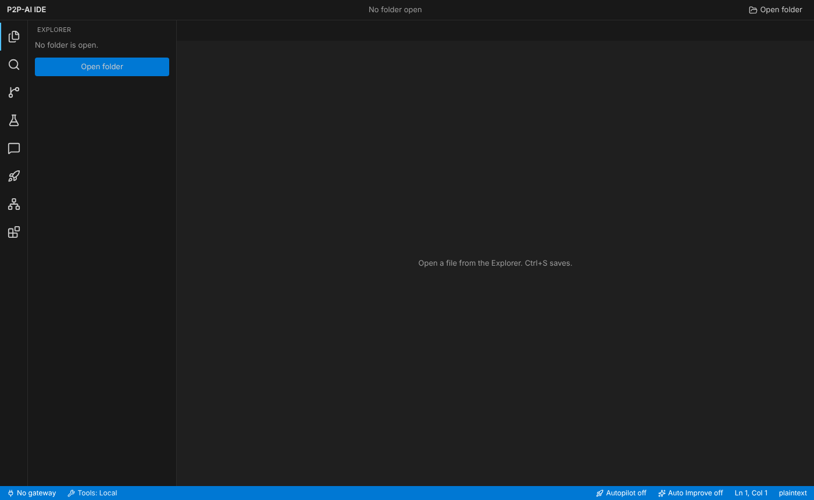
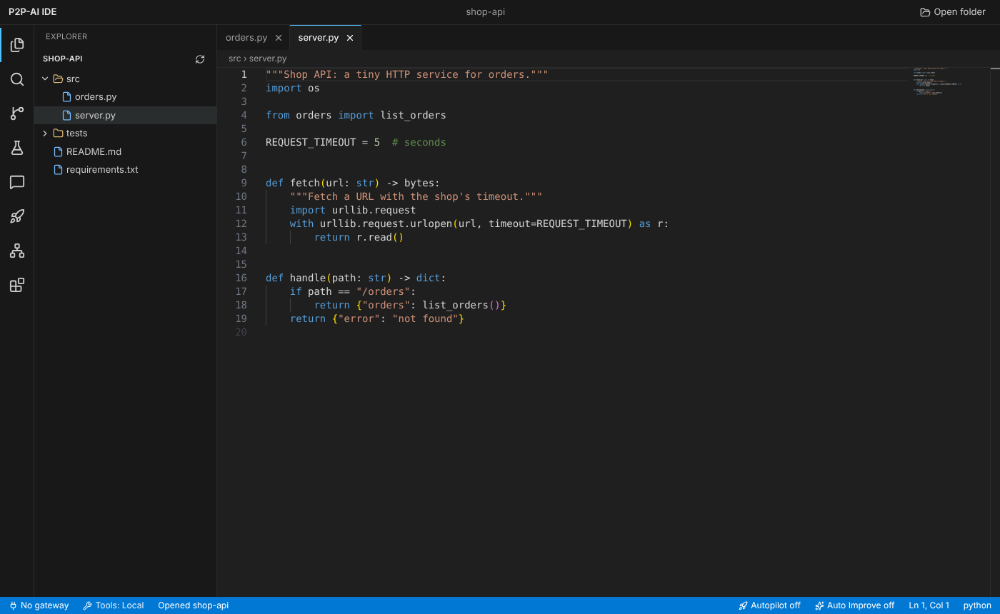
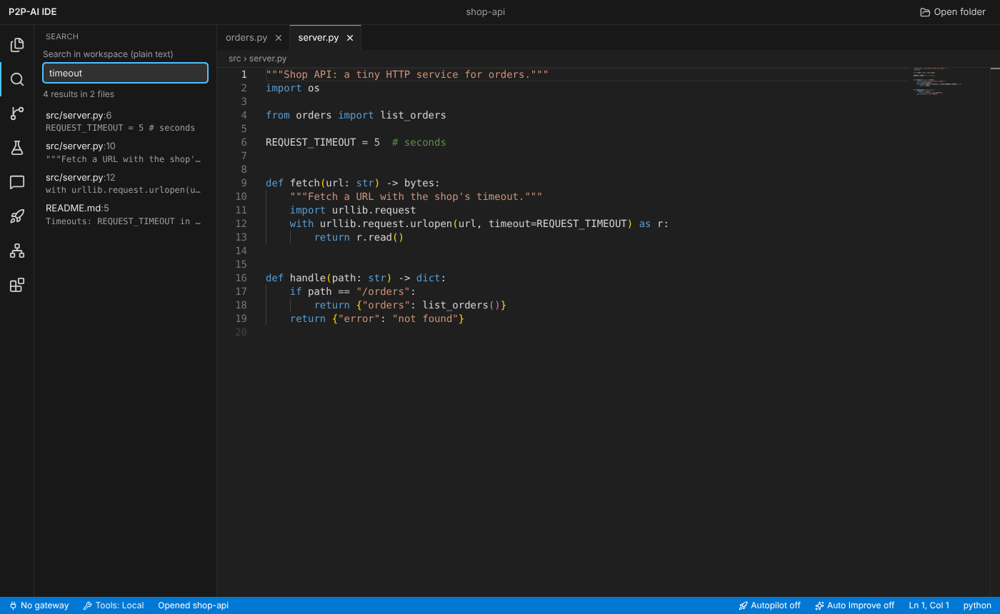
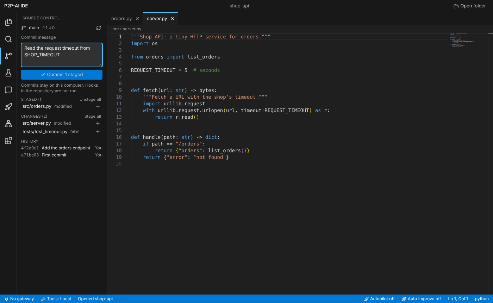
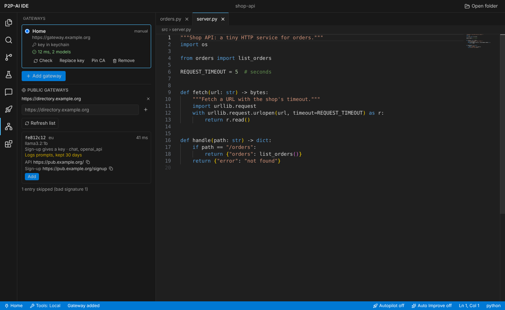
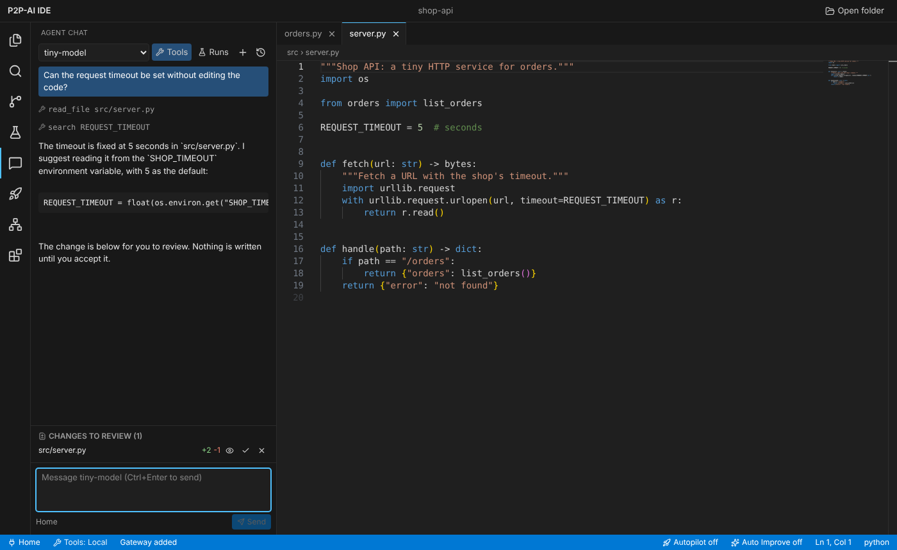
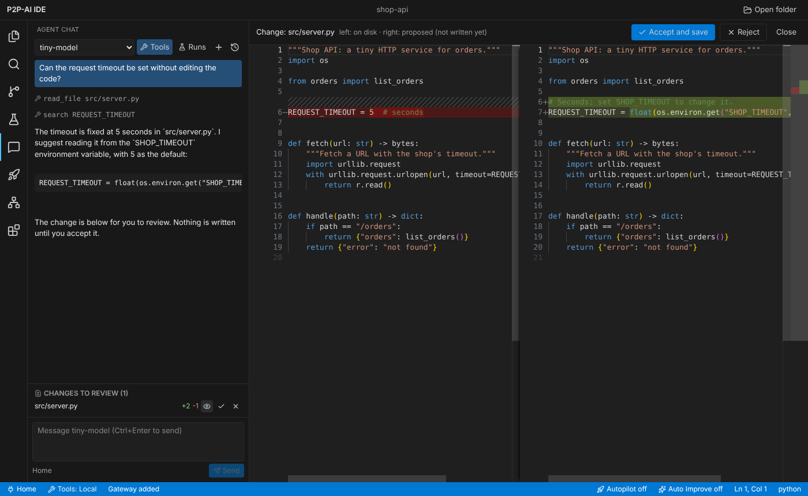
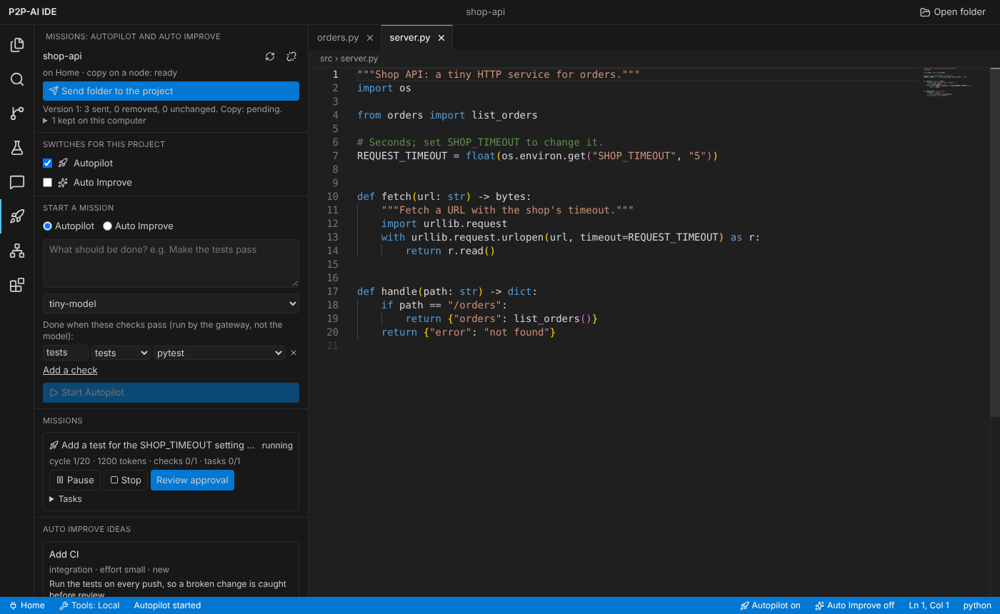
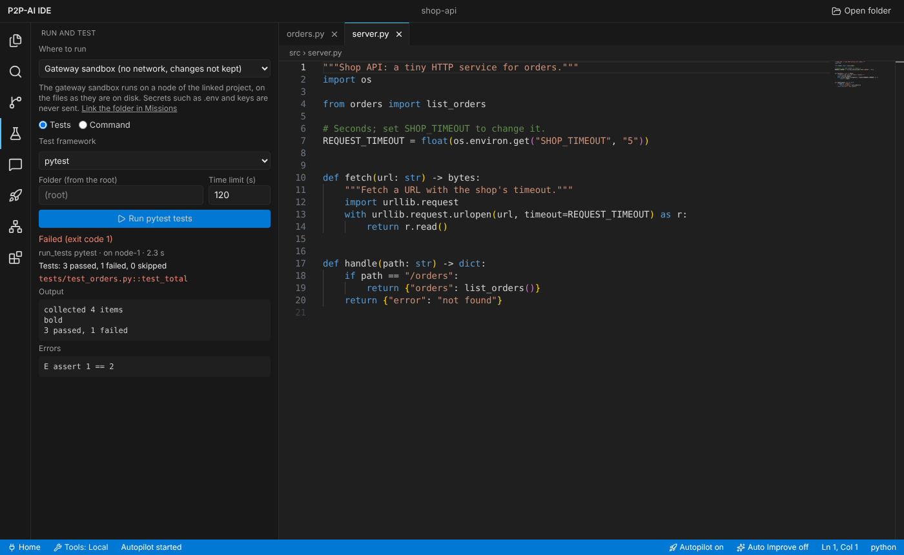
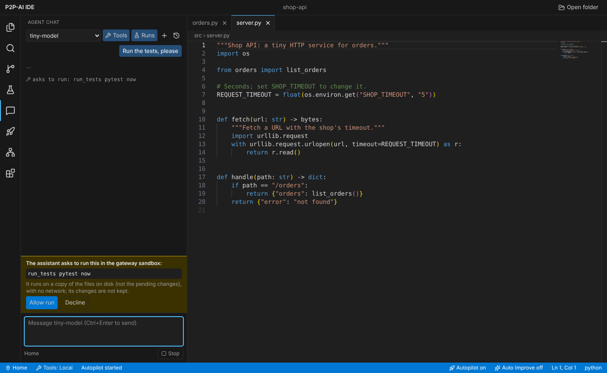

# P2P-AI IDE user guide: a screenshot tour

**Added 2026-11-17.** A picture-by-picture walk through the IDE, from opening a folder to letting an agent fix your
tests. For building and installing, see the [README](../README.md); for how each feature is protected, see the
pages in [features/](features/).

> **About these pictures.** They were taken from the real IDE interface with a small sample project ("shop-api") and a
> sample gateway (`gateway.example.org`, a made-up address). Your screens show your own files and gateways. The
> script that takes them is [described here](commands/docs-screenshots.md).

## Contents

1. [The window at a glance](#1-the-window-at-a-glance)
2. [Open a folder and edit](#2-open-a-folder-and-edit)
3. [Search](#3-search)
4. [Source control](#4-source-control)
5. [Connect to a gateway](#5-connect-to-a-gateway)
6. [Chat with the agent](#6-chat-with-the-agent)
7. [Review a proposed change](#7-review-a-proposed-change)
8. [Missions: Autopilot and Auto Improve](#8-missions-autopilot-and-auto-improve)
9. [Run and test](#9-run-and-test)
10. [Let the agent run tests, with your approval](#10-let-the-agent-run-tests-with-your-approval)
11. [How it keeps your code safe](#11-how-it-keeps-your-code-safe)

## 1. The window at a glance

If you have used VS Code, you will feel at home:

- **Activity bar** (the icons on the far left), top to bottom: Explorer, Search, Source control, Run and test, Agent
  chat, Missions, Gateways, Extensions (themes, grammars, snippets and web extensions from Open VSX; see
  [features/extensions.md](features/extensions.md)).
- **Side panel** next to it shows the view you picked.
- **Editor** in the middle, with tabs.
- **Status bar** at the bottom: the active gateway, where tools run (Tools: Local), the latest message, the
  **Autopilot** and **Auto Improve** switches, the cursor position and the file's language.

When no folder is open, the Explorer offers **Open folder**:



## 2. Open a folder and edit

1. Press **Open folder** (top right, or in the Explorer) and pick your project.
2. Click a file in the Explorer to open it in a tab. Folders open and close with a click.
3. Edit as usual: multi-cursor (Shift+Alt+Down on Linux, Ctrl+Alt+Down on Windows), find, undo. A dot on the tab
   means unsaved changes.
4. Press **Ctrl+S** to save. If someone (or another program) changed the file on disk since you opened it, the IDE
   does not overwrite it: a banner offers **Reload from disk** instead.



## 3. Search

Click the magnifier, type a word and press **Enter**. Results are grouped by file with the line number; click one to
open the file at that line. Search is plain text (no patterns), so any word works as typed.



## 4. Source control

The branch icon opens **Source control**, which uses the git already installed on your computer:

- **Changes** lists modified and new files; **+** stages one, **Stage all** stages everything.
- **Staged** lists what goes into the next commit; click a file to see its diff.
- Type a **commit message** and press **Commit**. Commits stay on your computer.
- **History** shows the latest commits.

For safety, the IDE turns off the repository's own hooks and programs (filters, signing) when it runs git. If a
repository asks git to run such programs, the view explains that it is off for that repository.



## 5. Connect to a gateway

The agent's models run on a P2P-AI **gateway**. Open the **Gateways** view (the network icon):

1. **Add gateway**: give it a name, its address (`https://...`) and your key, then **Add by address**. The key goes
   into your operating system's keychain and is never shown again ("key in keychain").
2. **Check** tests the connection and lists its models (for example "12 ms, 2 models").
3. **Public gateways**: add a directory address and press **Refresh list** to see gateways that welcome new users.
   Each one is checked against its signature, and the list shows its region, models, latency, how to sign up, and
   whether it keeps prompts. **Add** saves it.
4. **TandemForge on this computer**: if you run TandemForge, it can lend the IDE its local models. In TandemForge
   open Settings, Connected apps, and press **Connect**; copy the code it shows once. Here press **Pair with
   TandemForge** and paste it. Nothing leaves your computer.



## 6. Chat with the agent

Open **Agent chat** (the speech bubble). Pick a model, type your question, and press **Ctrl+Enter**.

- With **Tools** on, the assistant may look at your project: each step it takes (read a file, search) is shown as a
  small line in the chat, so you always see what it looked at.
- It never writes files itself. Any edit it suggests lands in **Changes to review** at the bottom of the panel.
- The clock button opens your **chat history**, which you can search; **+** starts a new chat.



## 7. Review a proposed change

Click the eye icon next to a file in **Changes to review**. The left side is the file on disk, the right side the
proposed version (not written yet). Then:

- **Accept and save** writes it. An open tab of that file reloads.
- **Reject** drops it. Nothing is written.

You can also accept (tick) or reject (cross) straight from the list.



## 8. Missions: Autopilot and Auto Improve

For a bigger goal, hand the work to the network as a **mission**. Open **Missions** (the rocket):

1. **Create project and link** makes a project on your gateway for this folder, and **Send folder to the project**
   uploads a copy. Files that may hold secrets, such as `.env`, stay on your computer.
2. Turn on the **Autopilot** switch for this project.
3. Write the **goal** (for example "add a test for the timeout setting and make every test pass"), pick a model and the
   checks that must pass (such as `pytest`), then **Start Autopilot**.
4. The mission shows its cycle, tokens, checks and tasks. When it wants to write a file, it waits: press **Review
   approval** to see exactly what it wants to write, then approve or deny. **Pause** and **Stop** are always there.
5. **Auto Improve ideas** lists suggestions (for example "Add CI") that you can accept or dismiss.
6. When work comes back, **Collect changes** and **Review changes** bring it into the same review as chat edits.



## 9. Run and test

The flask icon opens **Run and test**. Choose **where** to run:

- **Gateway sandbox**: on a node of the linked project, with no network; changes are not kept.
- **Local sandbox** on this computer (Linux and Windows), with no network and only the copy of your folder.
- **Local container**, Docker or Podman, using pinned Red Hat UBI images (Python, Node.js, Go, Rust).

Then pick **Tests** (choose the framework, such as pytest) or **Command** (a program and its arguments, never a shell
line), and press **Run**. The result shows the exit code, tests passed and failed, the failing test names, and the
output and errors.



## 10. Let the agent run tests, with your approval

In Agent chat, turn on **Runs** next to Tools. When the assistant wants to run something, a yellow card shows the
exact command and where it will run. Nothing happens until you press **Allow run**; **Decline** tells the assistant no.



## 11. How it keeps your code safe

- **You approve every write and every run.** Chat edits, mission writes and test runs all wait for you.
- **Runs are sandboxed** with no network, on a copy of your folder.
- **Keys stay in your OS keychain** and never go back to the window.
- **The agent can only see the open folder**: paths outside it, and files that may hold secrets, are refused.
- **Text from models is shown as text**, never run as code, under a strict Content-Security-Policy.

Each feature page in [features/](features/) lists its threats, controls and standards. Following them does not by
itself make an installation compliant with any framework; that needs an assessment.

## Retaking the screenshots

```
cd app
npm ci --ignore-scripts && npm run build
node tests/docs-shots.mjs            # writes docs/images/*.png
```

Details: [commands/docs-screenshots.md](commands/docs-screenshots.md). Test evidence for the current pictures:
[HistoryTest run](../HistoryTest/runs/2026-11-17_225231Z_docs-shots_64acea3/RUN.md).
